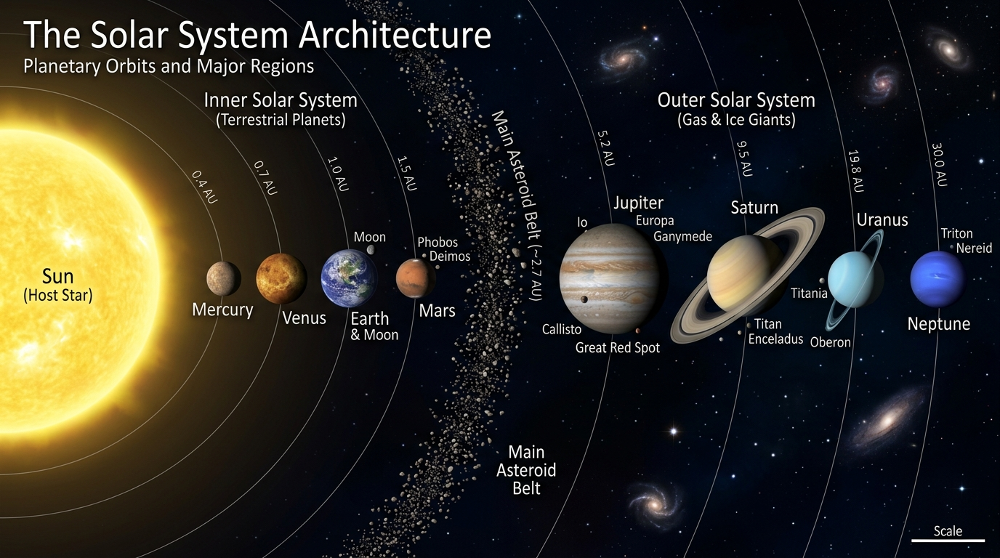

# 🌌 Учебник по Астрономии (*Podręcznik do Astronomii*)



Добро пожаловать в репозиторий иллюстрированного учебника по астрономии! В этом проекте собраны подробные конспекты, теории, формулы, задачи с решениями и наглядные научно-просветительские иллюстрации по всем разделам астрономии и астрофизики.

---

## 📚 Разделы и Темы (*Tematy*)

| Раздел / Тема | Описание и темы | Статус | Ссылка |
| :--- | :--- | :---: | :---: |
| **Тема 1** | **Единство мира. Природа Солнечной системы (*Układ Słoneczny*). Земля (*Ziemia*) — планета. Луна (*Księżyc*) — естественный спутник (*naturalny satelita*)** | ✅ Обновлено | [Перейти к Теме 1](Tema_01_Układ_Słoneczny_Ziemia_Księżyc.md) |
| **Проверочные вопросы (OAJ I этап)** | **Характерные параллели Земли, движение Земли и высота светила над горизонтом (*Podstawy geografii, wysokość obiektu, wysokość bieguna świata*)** | ✅ Добавлено | [Вопросы](Pytania_OAJ_1_stopien_Podstawy_geografii.md) / [Ответы](Odpowiedzi_OAJ_1_stopien_Podstawy_geografii.md) |

---

## 📖 Содержание Темы 1 (*Spis treści — Temat 1*)

1. [1. Строение Солнечной системы — *Budowa Układu Słonecznego* (O)](Tema_01_Układ_Słoneczny_Ziemia_Księżyc.md#1-строение-солнечной-системы--budowa-układu-słonecznego-o)
   * [1.1. Сводная физическая таблица планет Солнечной системы](Tema_01_Układ_Słoneczny_Ziemia_Księżyc.md#11-сводная-физическая-таблица-планет-солнечной-системы)
2. [2. Основные астрономические меры, единицы измерения и формулы перевода — *Podstawowe miary i jednostki astronomiczne*](Tema_01_Układ_Słoneczny_Ziemia_Księżyc.md#2-основные-астрономические-меры-единицы-измерения-и-формулы-перевода--podstawowe-miary-i-jednostki-astronomiczne)
   * [2.1. Единицы расстояний: чему равны и откуда взялись ($\text{au}$, $\text{ly}$, $\text{pc}$)](Tema_01_Układ_Słoneczny_Ziemia_Księżyc.md#21-единицы-расстояний-чему-равны-и-откуда-взялись-au-ly-pc)
   * [2.2. Единицы массы небесных тел: чему равны и откуда взялись ($M_\odot$, $M_\oplus$, $M_{\text{Jup}}$)](Tema_01_Układ_Słoneczny_Ziemia_Księżyc.md#22-единицы-массы-небесных-тел-чему-равны-и-откуда-взялись-m_odot-m_oplus-m_textjup)
   * [2.3. Формулы перевода величин (с легендами и примерами расчёта)](Tema_01_Układ_Słoneczny_Ziemia_Księżyc.md#23-формулы-перевода-величин-с-легендами-и-примерами-расчёта)
   * [2.4. Сводная таблица-шпаргалка основных мер и переводов](Tema_01_Układ_Słoneczny_Ziemia_Księżyc.md#24-сводная-таблица-шпаргалка-основных-мер-и-переводов)
3. [3. Метеороид, метеор и метеорит — *Meteoroid, meteor a meteoryt*](Tema_01_Układ_Słoneczny_Ziemia_Księżyc.md#3-метеороид-метеор-и-метеорит--meteoroid-meteor-a-meteoryt)
   * [3.1. Краткая шпаргалка (*Krótka ściągawka*)](Tema_01_Układ_Słoneczny_Ziemia_Księżyc.md#31-краткая-шпаргалка-krótka-ściągawka)
4. [4. Основные географические понятия и Высота объекта над горизонтом — *Podstawy geografii* (O)](Tema_01_Układ_Słoneczny_Ziemia_Księżyc.md#4-основные-географические-понятия-и-высота-объекта-над-горизонтом--podstawy-geografii-o)
   * [4.1. Характерные параллели и регионы Земли](Tema_01_Układ_Słoneczny_Ziemia_Księżyc.md#41-характерные-параллели-и-регионы-земли)
   * [4.2. Высота объекта над горизонтом и теорема о высоте полюса мира](Tema_01_Układ_Słoneczny_Ziemia_Księżyc.md#42-высота-объекта-над-горизонтом-и-теорема-о-высоте-полюса-мира)
5. [5. Эклиптика Земли — *Ekliptyka Ziemi*](Tema_01_Układ_Słoneczny_Ziemia_Księżyc.md#5-эклиптика-земли--ekliptyka-ziemi)
   * [5.1. Пересечение с небесным экватором и точки равноденствий](Tema_01_Układ_Słoneczny_Ziemia_Księżyc.md#51-пересечение-с-небесным-экватором-и-точки-равноденствий)
   * [5.2. Точки солнцестояния (*Przesilenia*)](Tema_01_Układ_Słoneczny_Ziemia_Księżyc.md#52-точки-солнцестояния-przesilenia)
   * [5.3. Созвездия эклиптики (Зодиакальный пояс — *Gwiazdozbiory ekliptyczne / Zodiak*)](Tema_01_Układ_Słoneczny_Ziemia_Księżyc.md#53-созвездия-эклиптики-зодиакальный-пояс--gwiazdozbiory-ekliptyczne--zodiak)
   * [5.4. Зодиакальный свет — *Światło zodiakalne*](Tema_01_Układ_Słoneczny_Ziemia_Księżyc.md#54-зодиакальный-свет--światło-zodiakalne)
   * [5.5. Лунные узлы — *Węzły księżycowe*](Tema_01_Układ_Słoneczny_Ziemia_Księżyc.md#55-лунные-узлы--węzły-księżycowe)
6. [6. Rozpoznawanie gwiazdozbiorów — Поиск созвездий и Полярной звезды](Tema_01_Układ_Słoneczny_Ziemia_Księżyc.md#6-rozpoznawanie-gwiazdozbiorów--поиск-созвездий-и-полярной-звезды)
   * [6.1. Как использовать Полярную звезду для ориентации](Tema_01_Układ_Słoneczny_Ziemia_Księżyc.md#61-как-использовать-полярную-звезду-для-ориентации-jak-wykorzystać-gwiazdę-polarną-do-orientacji-w-terenie--wyznaczania-kierunków-świata)
7. [7. Ruch jednostajny po okręgu — Равномерное движение по окружности](Tema_01_Układ_Słoneczny_Ziemia_Księżyc.md#7-ruch-jednostajny-po-okręgu--равномерное-движение-по-окружности)
   * [7.1. Кинематические параметры](Tema_01_Układ_Słoneczny_Ziemia_Księżyc.md#71-кинематические-параметры)
8. [8. Prędkość względna — Относительная скорость в астрономии](Tema_01_Układ_Słoneczny_Ziemia_Księżyc.md#8-prędkość-względna--относительная-скорость-в-астрономии)
   * [8.1. Частные случаи скалярного расчёта](Tema_01_Układ_Słoneczny_Ziemia_Księżyc.md#81-частные-случаи-скалярного-расчёта)
9. [9. Orbity kołowe — Круговые орбиты (O)](Tema_01_Układ_Słoneczny_Ziemia_Księżyc.md#9-orbity-kołowe--круговые-орбиты-o)
   * [9.1. Условие существования круговой орбиты и первая космическая скорость](Tema_01_Układ_Słoneczny_Ziemia_Księżyc.md#91-условие-существования-круговой-орбиты-и-первая-космическая-скорость)
   * [9.2. Связь радиуса орбиты и периода. III закон Кеплера (*III prawo Keplera*)](Tema_01_Układ_Słoneczny_Ziemia_Księżyc.md#92-связь-радиуса-орбиты-и-периода-iii-закон-кеплера-iii-prawo-keplera)
   * [9.3. Простой пример расчёта для планеты по III закону Кеплера](Tema_01_Układ_Słoneczny_Ziemia_Księżyc.md#93-простой-пример-расчёта-для-планеты-по-iii-закону-кеплера)
10. [10. Геометрия орбит и параметров: Перигелий, Афелий, Эксцентриситет](Tema_01_Układ_Słoneczny_Ziemia_Księżyc.md#10-геометрия-орбит-и-параметров-перигелий-афелий-эксцентриситет)
11. [11. Элонгация (*Elongacja*) и конфигурации планет](Tema_01_Układ_Słoneczny_Ziemia_Księżyc.md#11-элонгация-elongacja-и-конфигурации-планет)
12. [12. Форма и радиусы Земли (*Promienie Ziemi*)](Tema_01_Układ_Słoneczny_Ziemia_Księżyc.md#12-форма-и-радиусы-земли-promienie-ziemi)
13. [13. Расчёт суток в астрономии: Звёздные и Солнечные сутки (*Doba gwiazdowa a słoneczna*)](Tema_01_Układ_Słoneczny_Ziemia_Księżyc.md#13-расчёт-суток-в-астрономии-звёздные-и-солнечные-сутки-doba-gwiazdowa-a-słoneczna)
    * [13.1. Звёздные сутки (*Doba gwiazdowa*)](Tema_01_Układ_Słoneczny_Ziemia_Księżyc.md#131-звёздные-сутки-doba-gwiazdowa)
    * [13.2. Средние солнечные сутки (*Doba słoneczna*)](Tema_01_Układ_Słoneczny_Ziemia_Księżyc.md#132-средние-солнечные-сутки-doba-słoneczna)
    * [13.3. Вывод разницы 3 мин 56 с](Tema_01_Układ_Słoneczny_Ziemia_Księżyc.md#133-вывод-разницы-3-мин-56-с)
14. [14. Времена года и Высота Солнца над горизонтом (*Pory roku*) (O)](Tema_01_Układ_Słoneczny_Ziemia_Księżyc.md#14-времена-года-и-высота-солнца-над-горизонтом-pory-roku-o)
    * [14.1. Истинная причина смены времён года](Tema_01_Układ_Słoneczny_Ziemia_Księżyc.md#141-истинная-причина-смены-времён-года)
    * [14.2. Смещение точек восхода и заката Солнца в течение года (*Wschody i zachody Słońca w ciągu roku*)](Tema_01_Układ_Słoneczny_Ziemia_Księżyc.md#142-смещение-точек-восхода-и-заката-солнца-в-течение-года-wschody-i-zachody-słońca-w-ciągu-roku)
15. [15. Луна, фазы и затмения — *Księżyc, Fazy i Zaćmienia* (O)](Tema_01_Układ_Słoneczny_Ziemia_Księżyc.md#15-луна-фазы-и-затмения--księżyc-fazy-i-zaćmienia-o)
    * [15.1. Параметры Луны](Tema_01_Układ_Słoneczny_Ziemia_Księżyc.md#151-параметры-луны)
    * [15.2. Месяц сидерический и синодический, Фазы Луны (O)](Tema_01_Układ_Słoneczny_Ziemia_Księżyc.md#152-месяц-сидерический-и-синодический-фазы-луны-o)
    * [15.3. Затмения Солнца и Луны — *Zaćmienie Słońca i Księżyca* (O)](Tema_01_Układ_Słoneczny_Ziemia_Księżyc.md#153-затмения-солнца-и-луны--zaćmienie-słońca-i-księżyca-o)
    * [15.4. Геометрия орбит: теорема Пифагора и затмения (*Geometria orbit: twierdzenie Pitagorasa a zaćmienia*)](Tema_01_Układ_Słoneczny_Ziemia_Księżyc.md#154-геометрия-орбит-теорема-пифагора-и-затмения-geometria-orbit-twierdzenie-pitagorasa-a-zaćmienia)
16. [16. Математический аппарат, физика и геометрический инструментарий](Tema_01_Układ_Słoneczny_Ziemia_Księżyc.md#16-математический-аппарат-физика-и-геометрический-инструментарий)
    * [16.1. Закон всемирного тяготения Ньютона (*Prawo powszechnego ciążenia*)](Tema_01_Układ_Słoneczny_Ziemia_Księżyc.md#161-закон-всемирного-тяготения-ньютона-prawo-powszechnego-ciążenia)
    * [16.2. Ускорение свободного падения и Свободное падение тел](Tema_01_Układ_Słoneczny_Ziemia_Księżyc.md#162-ускорение-свободного-падения-и-свободное-падение-тел)
    * [16.3. Первая и Вторая космические скорости (*Pierwsza i druga prędkość kosmiczna*)](Tema_01_Układ_Słoneczny_Ziemia_Księżyc.md#163-первая-и-вторая-космические-скорости-pierwsza-i-druga-prędkość-kosmiczna)
    * [16.4. III закон Кеплера (*III prawo Keplera*)](Tema_01_Układ_Słoneczny_Ziemia_Księżyc.md#164-iii-закон-кеплера-iii-prawo-keplera)
    * [16.5. Закон инсоляции](Tema_01_Układ_Słoneczny_Ziemia_Księżyc.md#165-закон-инсоляции)
    * [16.6. Относительное движение и синодический период](Tema_01_Układ_Słoneczny_Ziemia_Księżyc.md#166-относительное-движение-и-синодический-период)
    * [16.7. Notacja wykładnicza i jednostki SI — Научная нотация и СИ](Tema_01_Układ_Słoneczny_Ziemia_Księżyc.md#167-notacja-wykładnicza-i-jednostki-si--научная-нотация-и-си)
    * [16.8. Obliczanie długości okręgu i pola koła — Геометрия круга и сферы](Tema_01_Układ_Słoneczny_Ziemia_Księżyc.md#168-obliczanie-długości-okręgu-i-pola-koła--геометрия-круга-и-сферы)
17. [17. Задачи для самостоятельного решения (*Zadania do samodzielnego rozwiązania*)](Tema_01_Układ_Słoneczny_Ziemia_Księżyc.md#17-задачи-для-самостоятельного-решения-zadania-do-samodzielnego-rozwiązania)
18. [18. Контрольные вопросы для самопроверки (*Pytania kontrolne*)](Tema_01_Układ_Słoneczny_Ziemia_Księżyc.md#18-контрольные-вопросы-для-самопроверки-pytania-kontrolne)
19. [19. Раздел решений задач и ответов (*Rozwiązania zadań i Odpowiedzi*)](Tema_01_Układ_Słoneczny_Ziemia_Księżyc.md#19-раздел-решений-задач-и-ответов-rozwiązania-zadań-i-odpowiedzi)
    * [19.1. Подробные решения задач из Раздела 17](Tema_01_Układ_Słoneczny_Ziemia_Księżyc.md#191-подробные-решения-задач-из-раздела-17)
    * [19.2. Ответы на контрольные вопросы из Раздела 18](Tema_01_Układ_Słoneczny_Ziemia_Księżyc.md#192-ответы-на-контрольные-вопросы-из-раздела-18)

---

## 📐 Основные астрономические меры, константы и формулы перевода

*(Подробное объяснение того, откуда взялись эти меры, и примеры расчёта см. в [Разделе 2 Темы 1](Tema_01_Układ_Słoneczny_Ziemia_Księżyc.md#2-основные-астрономические-меры-единицы-измерения-и-формулы-перевода--podstawowe-miary-i-jednostki-astronomiczne))*

| Величина и обозначение | Польское название | Точное / стандартное значение в СИ | Соотношение с другими единицами |
| :--- | :--- | :--- | :--- |
| **Астрономическая единица** ($\text{au}$) | *Jednostka astronomiczna* ($\text{j.a.}$) | $149\,597\,870\,700\text{ м} \approx 1{,}496 \cdot 10^{11}\text{ м}$ | $\approx 149{,}6\text{ млн км} \approx 4{,}848 \cdot 10^{-6}\text{ pc}$ |
| **Световой год** ($\text{ly}$) | *Rok świetlny* ($\text{r.ś.}$) | $9\,460\,730\,472\,580\,800\text{ м} \approx 9{,}46 \cdot 10^{15}\text{ м}$ | $\approx 63\,241\text{ au} \approx 0{,}3066\text{ pc}$ |
| **Парсек** ($\text{pc}$) | *Parsek* ($\text{pc}$) | $\approx 3{,}0857 \cdot 10^{16}\text{ м}$ | $\approx 3{,}2616\text{ ly} \approx 206\,265\text{ au}$ |
| **Масса Солнца** ($M_\odot$) | *Masa Słońca* ($M_\odot$) | $1\,988\,500\,000\,000\,000\,000\,000\,000\,000\,000\text{ кг} \approx 1{,}9885 \cdot 10^{30}\text{ кг}$ | $\approx 332\,946\,M_\oplus \approx 1047\,M_{\text{Jup}}$ |
| **Масса Земли** ($M_\oplus$) | *Masa Ziemi* ($M_\oplus$) | $5\,972\,200\,000\,000\,000\,000\,000\,000\text{ кг} \approx 5{,}9722 \cdot 10^{24}\text{ кг}$ | $\approx 3{,}003 \cdot 10^{-6}\,M_\odot \approx 81{,}3\,M_{\text{Moon}}$ |

* **Перевод астрономических единиц ($\text{au}$) в метры и километры**:
  $$d_{\text{[м]}} = d_{\text{[au]}} \times 1{,}496 \cdot 10^{11}, \qquad d_{\text{[км]}} = d_{\text{[au]}} \times 149{,}6 \cdot 10^{6}$$

* **Перевод массы из масс Солнца ($M_\odot$) и масс Земли ($M_\oplus$) в килограммы**:
  $$M_{\text{[кг]}} = n_{\odot} \times 1{,}9885 \cdot 10^{30}\text{ кг}, \qquad M_{\text{[кг]}} = n_{\oplus} \times 5{,}9722 \cdot 10^{24}\text{ кг}$$

* **Перевод между парсеками ($\text{pc}$), световыми годами ($\text{ly}$), $\text{au}$ и метрами**:
  $$d_{\text{[ly]}} = d_{\text{[pc]}} \times 3{,}2616, \qquad d_{\text{[au]}} = d_{\text{[pc]}} \times 206\,265, \qquad d_{\text{[м]}} = d_{\text{[ly]}} \times 9{,}46 \cdot 10^{15}$$

* **Соотношение звёздных и солнечных суток**:
  $$T_{\text{sid}} = 23^{\text{h}} 56^{\text{m}} 04{,}09\text{s}, \quad T_{\text{sol}} = 24^{\text{h}} 00^{\text{m}} 00\text{s} \quad \implies \quad \frac{1}{T_{\text{sol}}} = \frac{1}{T_{\text{sid}}} - \frac{1}{T_{\text{rev}}}$$

---

## 📂 Структура репозитория

```text
astronomia/
├── README.md                                          # Главный индекс и описание курса
├── Tema_01_Układ_Słoneczny_Ziemia_Księżyc.md          # Подробный конспект Тема 1
├── Pytania_OAJ_1_stopien_Podstawy_geografii.md        # Проверочные вопросы к I туру OAJ
├── Odpowiedzi_OAJ_1_stopien_Podstawy_geografii.md     # Ключи и ответы к проверочным вопросам
└── images/                                            # Научные иллюстрации и схемы
    ├── solar_system_structure.jpg
    ├── geographic_coordinates_grid.jpg
    ├── ecliptic_celestial_sphere.jpg
    ├── ecliptic_constellations.jpg
    ├── zodiacal_light.jpg
    ├── earth_radii_ellipsoid.jpg
    ├── orbital_parameters_apsides.jpg
    ├── elongation_configurations.jpg
    ├── earth_interior_layers.jpg
    ├── seasons_earth_orbit.jpg
    ├── moon_phases_eclipses.jpg
    ├── ecliptic_moon_nodes.jpg
    └── earth_magnetosphere_aurora.jpg
```

---

*Автор проекта: Oksana Bukina*  
*Материалы соответствуют требованиям учебной программы и подготовке к Астрономическим олимпиадам.*
