# Учебник по астрономии. Тема 1

## Единство мира. Природа Солнечной системы (*Układ Słoneczny*). Земля (*Ziemia*) — планета. Луна (*Księżyc*) — естественный спутник (*naturalny satelita*)

---

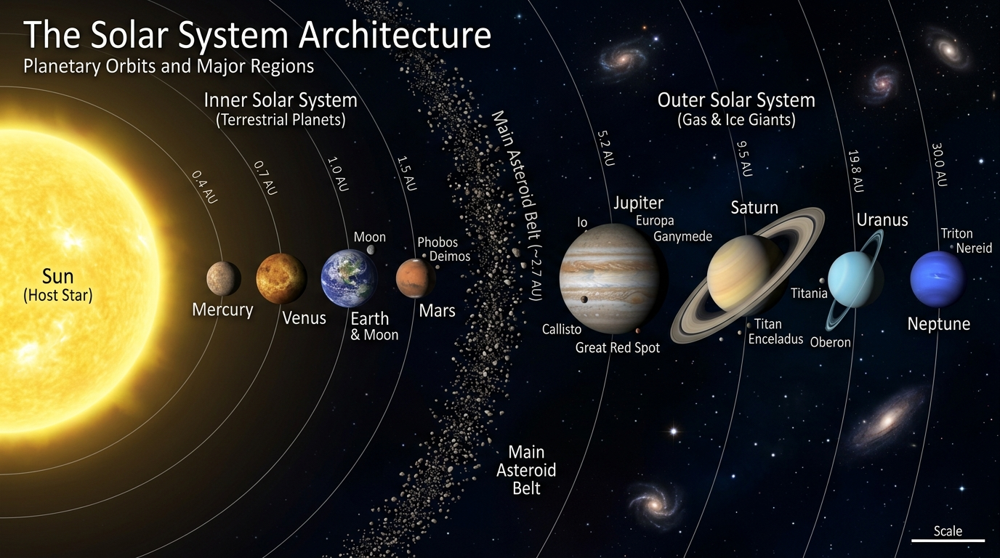

---

## 📖 Содержание (*Spis treści*)

1. [1. Строение Солнечной системы — *Budowa Układu Słonecznego* (O)](#1-строение-солнечной-системы--budowa-układu-słonecznego-o)
   * [1.1. Сводная физическая таблица планет Солнечной системы](#11-сводная-физическая-таблица-планет-солнечной-системы)
2. [2. Основные астрономические меры, единицы измерения и формулы перевода — *Podstawowe miary i jednostki astronomiczne*](#2-основные-астрономические-меры-единицы-измерения-и-формулы-перевода--podstawowe-miary-i-jednostki-astronomiczne)
   * [2.1. Единицы расстояний: чему равны и откуда взялись ($\text{au}$, $\text{ly}$, $\text{pc}$)](#21-единицы-расстояний-чему-равны-и-откуда-взялись-au-ly-pc)
   * [2.2. Единицы массы небесных тел: чему равны и откуда взялись ($M_\odot$, $M_\oplus$, $M_{\text{Jup}}$)](#22-единицы-массы-небесных-тел-чему-равны-и-откуда-взялись-m_odot-m_oplus-m_textjup)
   * [2.3. Формулы перевода величин (с легендами и примерами расчёта)](#23-формулы-перевода-величин-с-легендами-и-примерами-расчёта)
   * [2.4. Сводная таблица-шпаргалка основных мер и переводов](#24-сводная-таблица-шпаргалка-основных-мер-и-переводов)
3. [3. Метеороид, метеор и метеорит — *Meteoroid, meteor a meteoryt*](#3-метеороид-метеор-и-метеорит--meteoroid-meteor-a-meteoryt)
   * [3.1. Краткая шпаргалка (*Krótka ściągawka*)](#31-краткая-шпаргалка-krótka-ściągawka)
4. [4. Основные географические понятия и Высота объекта над горизонтом — *Podstawy geografii* (O)](#4-основные-географические-понятия-и-высота-объекта-над-горизонтом--podstawy-geografii-o)
   * [4.1. Характерные параллели и регионы Земли](#41-характерные-параллели-и-регионы-земли)
   * [4.2. Высота объекта над горизонтом и теорема о высоте полюса мира](#42-высота-объекта-над-горизонтом-и-теорема-о-высоте-полюса-мира)
5. [5. Эклиптика Земли — *Ekliptyka Ziemi*](#5-эклиптика-земли--ekliptyka-ziemi)
   * [5.1. Пересечение с небесным экватором и точки равноденствий](#51-пересечение-с-небесным-экватором-и-точки-равноденствий)
   * [5.2. Точки солнцестояния (*Przesilenia*)](#52-точки-солнцестояния-przesilenia)
   * [5.3. Созвездия эклиптики (Зодиакальный пояс — *Gwiazdozbiory ekliptyczne / Zodiak*)](#53-созвездия-эклиптики-зодиакальный-пояс--gwiazdozbiory-ekliptyczne--zodiak)
   * [5.4. Зодиакальный свет — *Światło zodiakalne*](#54-зодиакальный-свет--światło-zodiakalne)
   * [5.5. Лунные узлы — *Węzły księżycowe*](#55-лунные-узлы--węzły-księżycowe)
6. [6. Rozpoznawanie gwiazdozbiorów — Поиск созвездий и Полярной звезды](#6-rozpoznawanie-gwiazdozbiorów--поиск-созвездий-и-полярной-звезды)
   * [6.1. Как использовать Полярную звезду для ориентации](#61-как-использовать-полярную-звезду-для-ориентации-jak-wykorzystać-gwiazdę-polarną-do-orientacji-w-terenie--wyznaczania-kierunków-świata)
7. [7. Ruch jednostajny po okręgu — Равномерное движение по окружности](#7-ruch-jednostajny-po-okręgu--равномерное-движение-по-окружности)
   * [7.1. Кинематические параметры](#71-кинематические-параметры)
8. [8. Prędkość względna — Относительная скорость в астрономии](#8-prędkość-względna--относительная-скорость-в-астрономии)
   * [8.1. Частные случаи скалярного расчёта](#81-частные-случаи-скалярного-расчёта)
9. [9. Orbity kołowe — Круговые орбиты (O)](#9-orbity-kołowe--круговые-орбиты-o)
   * [9.1. Условие существования круговой орбиты и первая космическая скорость](#91-условие-существования-круговой-орбиты-и-первая-космическая-скорость)
   * [9.2. Связь радиуса орбиты и периода. III закон Кеплера (*III prawo Keplera*)](#92-связь-радиуса-орбиты-и-периода-iii-закон-кеплера-iii-prawo-keplera)
   * [9.3. Простой пример расчёта для планеты по III закону Кеплера](#93-простой-пример-расчёта-для-планеты-по-iii-закону-кеплера)
10. [10. Геометрия орбит и параметров: Перигелий, Афелий, Эксцентриситет](#10-геометрия-орбит-и-параметров-перигелий-афелий-эксцентриситет)
11. [11. Элонгация (*Elongacja*) и конфигурации планет](#11-элонгация-elongacja-и-конфигурации-планет)
12. [12. Форма и радиусы Земли (*Promienie Ziemi*)](#12-форма-и-радиусы-земли-promienie-ziemi)
13. [13. Расчёт суток в астрономии: Звёздные и Солнечные сутки (*Doba gwiazdowa a słoneczna*)](#13-расчёт-суток-в-астрономии-звёздные-и-солнечные-сутки-doba-gwiazdowa-a-słoneczna)
    * [13.1. Звёздные сутки (*Doba gwiazdowa*)](#131-звёздные-сутки-doba-gwiazdowa)
    * [13.2. Средние солнечные сутки (*Doba słoneczna*)](#132-средние-солнечные-сутки-doba-słoneczna)
    * [13.3. Вывод разницы 3 мин 56 с](#133-вывод-разницы-3-мин-56-с)
14. [14. Времена года и Высота Солнца над горизонтом (*Pory roku*) (O)](#14-времена-года-и-высота-солнца-над-горизонтом-pory-roku-o)
    * [14.1. Истинная причина смены времён года](#141-истинная-причина-смены-времён-года)
    * [14.2. Смещение точек восхода и заката Солнца в течение года (*Wschody i zachody Słońca w ciągu roku*)](#142-смещение-точек-восхода-и-заката-солнца-в-течение-года-wschody-i-zachody-słońca-w-ciągu-roku)
15. [15. Луна, фазы и затмения — *Księżyc, Fazy i Zaćmienia* (O)](#15-луна-фазы-и-затмения--księżyc-fazy-i-zaćmienia-o)
    * [15.1. Параметры Луны](#151-параметры-луны)
    * [15.2. Месяц сидерический и синодический, Фазы Луны (O)](#152-месяц-сидерический-и-синодический-фазы-луны-o)
    * [15.3. Затмения Солнца и Луны — *Zaćmienie Słońca i Księżyca* (O)](#153-затмения-солнца-и-луны--zaćmienie-słońca-i-księżyca-o)
    * [15.4. Геометрия орбит: теорема Пифагора и затмения (*Geometria orbit: twierdzenie Pitagorasa a zaćmienia*)](#154-геометрия-орбит-теорема-пифагора-и-затмения-geometria-orbit-twierdzenie-pitagorasa-a-zaćmienia)
16. [16. Математический аппарат, физика и геометрический инструментарий](#16-математический-аппарат-физика-и-геометрический-инструментарий)
    * [16.1. Закон всемирного тяготения Ньютона (*Prawo powszechnego ciążenia*)](#161-закон-всемирного-тяготения-ньютона-prawo-powszechnego-ciążenia)
    * [16.2. Ускорение свободного падения и Свободное падение тел](#162-ускорение-свободного-падения-и-свободное-падение-тел)
    * [16.3. Первая и Вторая космические скорости (*Pierwsza i druga prędkość kosmiczna*)](#163-первая-и-вторая-космические-скорости-pierwsza-i-druga-prędkość-kosmiczna)
    * [16.4. III закон Кеплера (*III prawo Keplera*)](#164-iii-закон-кеплера-iii-prawo-keplera)
    * [16.5. Закон инсоляции](#165-закон-инсоляции)
    * [16.6. Относительное движение и синодический период](#166-относительное-движение-и-синодический-период)
    * [16.7. Notacja wykładnicza i jednostki SI — Научная нотация и СИ](#167-notacja-wykładnicza-i-jednostki-si--научная-нотация-и-си)
    * [16.8. Obliczanie długości okręgu i pola koła — Геометрия круга и сферы](#168-obliczanie-długości-okręgu-i-pola-koła--геометрия-круга-и-сферы)
17. [17. Задачи для самостоятельного решения (*Zadania do samodzielnego rozwiązania*)](#17-задачи-для-самостоятельного-решения-zadania-do-samodzielnego-rozwiązania)
18. [18. Контрольные вопросы для самопроверки (*Pytania kontrolne*)](#18-контрольные-вопросы-для-самопроверки-pytania-kontrolne)
19. [19. Раздел решений задач и ответов (*Rozwiązania zadań i Odpowiedzi*)](#19-раздел-решений-задач-и-ответов-rozwiązania-zadań-i-odpowiedzi)
    * [19.1. Подробные решения задач из Раздела 17](#191-подробные-решения-задач-из-раздела-17)
    * [19.2. Ответы на контрольные вопросы из Раздела 18](#192-ответы-на-контрольные-вопросы-из-раздела-18)

---

### 1. Строение Солнечной системы — *Budowa Układu Słonecznego* (O)

**Солнечная система (*Układ Słoneczny*)** — это гравитационно связанная планетная система (*układ planetarny*), состоящая из центральной звезды — Солнца (*Słońce*) — и всех обращающихся вокруг него по гелиоцентрическим орбитам небесных тел:

* **Солнце (*Słońce*)** — центральное массивное тело системы, сосредоточившее $99{,}86\%$ всей массы Солнечной системы:
  $$\mathbf{M_\odot \approx 1\,988\,500\,000\,000\,000\,000\,000\,000\,000\,000\text{ кг}} \quad (1{,}9885 \cdot 10^{30}\text{ кг})$$
* **8 главных планет (*8 planet*)** — классические планеты, движущиеся по эллиптическим гелиоцентрическим орбитам, близким к круговым.
* **Естественные спутники планет (*naturalne satelity planet*)** — небесные тела, обращающиеся вокруг планет по околопланетным орбитам.
* **Карликовые планеты (*planety karłowate*)** — объекты гидростатического равновесия, не расчистившие свою орбиту (например, Плутон — *Pluton*, Церера — *Ceres*, Эрида — *Eris*).
* **Малые тела Солнечной системы**:
  * **Астероиды (*planetoidy / asteroidy*)** — каменистые малые тела в Главном поясе астероидов (*pas planetoid*) между Марсом и Юпитером ($2{,}1\text{--}3{,}3\text{ au}$).
  * **Кометы (*komety*)** — ледяные малые тела из пояса Койпера (*pas Kuipera*) и облака Оорта (*obłok Oorta*).
  * **Метеороиды (*meteoroidy*)**, метеоры (*meteory*) и метеориты (*meteoryty*).
  * **Межпланетное вещество (*materia międzyplanetarna*)** и солнечный ветер (*wiatr słoneczny*).

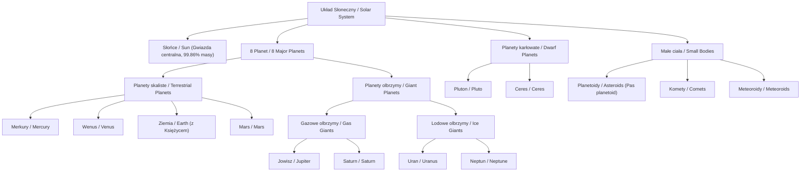

---

#### 1.1. Сводная физическая таблица планет Солнечной системы

Точные значения масс (в точных числах и научной нотации), радиусов, плотностей и ускорений свободного падения:

| Небесное тело | Название по-польски | Масса $M$ (в точных числах кг) | Масса $M / M_\oplus$ | Средний радиус $R$ (км) | Плотность $\rho$ (г/см³) | Ускорение $g$ (м/с²) |
| :--- | :--- | :---: | :---: | :---: | :---: | :---: |
| **Солнце** | *Słońce* | $1\,988\,500\,000\,000\,000\,000\,000\,000\,000\,000$ | $332\,946$ | $696\,340$ | $1{,}408$ | $274{,}0$ |
| **Меркурий** | *Merkury* | $330\,110\,000\,000\,000\,000\,000\,000$ | $0{,}0553$ | $2439{,}7$ | $5{,}427$ | $3{,}70$ |
| **Венера** | *Wenus* | $4\,867\,500\,000\,000\,000\,000\,000\,000$ | $0{,}8150$ | $6051{,}8$ | $5{,}243$ | $8{,}87$ |
| **Земля** | *Ziemia* | $\mathbf{5\,972\,200\,000\,000\,000\,000\,000\,000}$ | $\mathbf{1{,}0000}$ | $\mathbf{6371{,}0}$ | $\mathbf{5{,}515}$ | $\mathbf{9{,}81}$ |
| **Марс** | *Mars* | $641\,710\,000\,000\,000\,000\,000\,000$ | $0{,}1074$ | $3389{,}5$ | $3{,}933$ | $3{,}71$ |
| **Юпитер** | *Jowisz* | $1\,898\,200\,000\,000\,000\,000\,000\,000\,000$ | $317{,}83$ | $69911$ | $1{,}326$ | $24{,}79$ |
| **Сатурн** | *Saturn* | $568\,340\,000\,000\,000\,000\,000\,000\,000$ | $95{,}16$ | $58232$ | $0{,}687$ | $10{,}44$ |
| **Уран** | *Uran* | $86\,810\,000\,000\,000\,000\,000\,000\,000$ | $14{,}54$ | $25362$ | $1{,}270$ | $8{,}69$ |
| **Нептун** | *Neptun* | $102\,410\,000\,000\,000\,000\,000\,000\,000$ | $17{,}15$ | $24622$ | $1{,}638$ | $11{,}15$ |
| **Луна (спутник)**| *Księżyc* | $73\,420\,000\,000\,000\,000\,000\,000$ | $0{,}0123$ ($\frac{1}{81,3}$) | $1737{,}1$ | $3{,}344$ | $1{,}62$ |

---

### 2. Основные астрономические меры, единицы измерения и формулы перевода — *Podstawowe miary i jednostki astronomiczne*

В космосе расстояния и массы настолько огромны, что измерять их обычными метрами или килограммами неудобно — числа содержат десятки нулей. Поэтому астрономы ввели специальные эталонные меры. Ниже подробно разобрано, **чему они равны**, **откуда взялись** и **как переводить одни величины в другие**.

---

#### 2.1. Единицы расстояний: чему равны и откуда взялись ($\text{au}$, $\text{ly}$, $\text{pc}$)

1. **Астрономическая единица (*jednostka astronomiczna*, $\text{au}$ / $\text{j.a.}$)**:
   * **Чему равна**:
     $$\mathbf{1\text{ au} = 149\,597\,870\,700\text{ м} \approx 149{,}6\text{ млн км} \approx 1{,}496 \cdot 10^{11}\text{ м}}$$
   * **Откуда взялась**: Исторически за $1\text{ au}$ было принято **среднее расстояние от Земли до Солнца** (большая полуось орбиты Земли: среднее между минимальным расстоянием в перигелии $\approx 147{,}1\text{ млн км}$ и максимальным в афелии $\approx 152{,}1\text{ млн км}$). В 2012 году Международный астрономический союз (IAU) закрепил за $1\text{ au}$ точное фиксированное значение в метрах.
   * **Где применяется**: Для измерения расстояний **внутри Солнечной системы** (между планетами, поясом астероидов, кометами).

2. **Световой год (*rok świetlny*, $\text{ly}$ / $\text{r.ś.}$)**:
   * **Чему равен**:
     $$\mathbf{1\text{ ly} = 9\,460\,730\,472\,580\,800\text{ м} \approx 9{,}46 \cdot 10^{15}\text{ м} \approx 9{,}46\text{ трлн км} \approx 63\,241\text{ au}}$$
   * **Откуда взялся**: Это **расстояние** (а не время!), которое луч света в вакууме проходит за один стандартный юлианский год ($t = 365{,}25\text{ суток} = 31\,557\,600\text{ секунд}$), двигаясь со скоростью света $c = 299\,792\,458\text{ м/с}$:
     $$1\text{ ly} = c \cdot t = 299\,792\,458\text{ м/с} \times 31\,557\,600\text{ с} \approx 9{,}46 \cdot 10^{15}\text{ м}$$
   * **Где применяется**: В научно-популярной и учебной астрономии для измерения расстояний до звёзд, туманностей и галактик.

3. **Парсек (*parsek*, $\text{pc}$)**:
   * **Чему равен**:
     $$\mathbf{1\text{ pc} \approx 30\,856\,775\,814\,913\,673\text{ м} \approx 3{,}086 \cdot 10^{16}\text{ м} \approx 30{,}86\text{ трлн км} \approx 3{,}2616\text{ ly} \approx 206\,265\text{ au}}$$
   * **Откуда взялся**: Слово составлено из сокращения **«пар**аллакс + угловая **сек**унда» (*parallax of one arcsecond*). Это расстояние, с которого средний радиус земной орбиты ($1\text{ au}$) виден перпендикулярно под углом **годичного параллакса $\pi = 1''$** (одна угловая секунда $= \frac{1^\circ}{3600}$). Поскольку в $1$ радиане содержится $\frac{180^\circ \times 3600''}{\pi} \approx 206\,265''$, из прямоугольного треугольника получаем:
     $$1\text{ pc} = \frac{1\text{ au}}{\tan 1''} \approx 206\,265\text{ au}$$
   * **Где применяется**: Главная профессиональная единица расстояний в астрофизике и космологии (вместе с кратными единицами: килопарсек $1\text{ kpc} = 10^3\text{ pc}$ и мегапарсек $1\text{ Mpc} = 10^6\text{ pc}$).

---

#### 2.2. Единицы массы небесных тел: чему равны и откуда взялись ($M_\odot$, $M_\oplus$, $M_{\text{Jup}}$)

1. **Масса Солнца (*masa Słońca*, $M_\odot$)**:
   * **Чему равна**:
     $$\mathbf{1\,M_\odot \approx 1\,988\,500\,000\,000\,000\,000\,000\,000\,000\,000\text{ кг} \approx 1{,}9885 \cdot 10^{30}\text{ кг} \approx 2 \cdot 10^{30}\text{ кг}}$$
   * **Откуда взялась**: Массу Солнца невозможно «взвесить» напрямую, но её точно вычислили с помощью **закона всемирного тяготения Ньютона и III закона Кеплера** по известному радиусу орбиты Земли ($r = 1\text{ au}$) и периоду её обращения ($T = 1\text{ год} \approx 3{,}156 \cdot 10^7\text{ с}$):
     $$M_\odot = \frac{4\pi^2 r^3}{G T^2}$$
   * **Где применяется**: Эталонная единица в астрофизике для измерения масс **звёзд, белых карликов, нейтронных звёзд, чёрных дыр, звёздных скоплений и галактик**.

2. **Масса Земли (*masa Ziemi*, $M_\oplus$)**:
   * **Чему равна**:
     $$\mathbf{1\,M_\oplus \approx 5\,972\,200\,000\,000\,000\,000\,000\,000\text{ кг} \approx 5{,}9722 \cdot 10^{24}\text{ кг} \approx 6 \cdot 10^{24}\text{ кг}}$$
   * **Откуда взялась**: Вычислена из формулы ускорения свободного падения на поверхности Земли ($g = \frac{G M_\oplus}{R_\oplus^2}$) после того, как Генри Кавендиш в 1798 году измерил гравитационную постоянную $G$:
     $$M_\oplus = \frac{g R_\oplus^2}{G}$$
   * **Где применяется**: Для сравнения масс планет Солнечной системы (см. колонку $M / M_\oplus$ в таблице 1.1), спутников и каменистых экзопланет («суперземель»). Соотношение с массой Солнца:
     $$1\,M_\odot \approx 332\,946\,M_\oplus$$

3. **Масса Юпитера (*masa Jowisza*, $M_{\text{Jup}}$)**:
   * **Чему равна**:
     $$\mathbf{1\,M_{\text{Jup}} \approx 1{,}8982 \cdot 10^{27}\text{ кг} \approx 317{,}83\,M_\oplus \approx \frac{1}{1047}\,M_\odot}$$
   * **Где применяется**: Для измерения масс газовых гигантов, коричневых карликов и крупных экзопланет.

---

#### 2.3. Формулы перевода величин (с легендами и примерами расчёта)

##### А) Перевод астрономических единиц ($\text{au}$) в метры ($\text{м}$) и километры ($\text{км}$)

$$\mathbf{d_{\text{[м]}} = d_{\text{[au]}} \times 1{,}496 \cdot 10^{11}} \qquad \text{и} \qquad \mathbf{d_{\text{[au]}} = \frac{d_{\text{[м]}}}{1{,}496 \cdot 10^{11}}}$$

$$\mathbf{d_{\text{[км]}} = d_{\text{[au]}} \times 149{,}6 \cdot 10^{6}} \qquad \text{и} \qquad \mathbf{d_{\text{[au]}} = \frac{d_{\text{[км]}}}{149{,}6 \cdot 10^{6}}}$$

где:
* $d_{\text{[au]}}$ — расстояние, выраженное в астрономических единицах ($\text{au}$);
* $d_{\text{[м]}}$ — то же расстояние в метрах ($\text{м}$);
* $d_{\text{[км]}}$ — то же расстояние в километрах ($\text{км}$);
* $1{,}496 \cdot 10^{11}\text{ м}$ ($149\,597\,870\,700\text{ м}$) — количество метров в $1\text{ au}$.

> **Пример 1**: Марс находится на среднем расстоянии $d = 1{,}52\text{ au}$ от Солнца. Выразите это расстояние в метрах и миллионах километров.
> * **В метрах**: $d_{\text{[м]}} = 1{,}52 \times 1{,}496 \cdot 10^{11}\text{ м} \approx \mathbf{2{,}274 \cdot 10^{11}\text{ м}}$.
> * **В километрах**: $d_{\text{[км]}} = 1{,}52 \times 149{,}6\text{ млн км} \approx \mathbf{227{,}4\text{ млн км}}$.

---

##### Б) Перевод массы любого космического объекта из масс Солнца ($M_\odot$) или масс Земли ($M_\oplus$) в килограммы ($\text{кг}$)

$$\mathbf{M_{\text{[кг]}} = n_{\odot} \times M_\odot = n_{\odot} \times 1{,}9885 \cdot 10^{30}\text{ кг}} \qquad \Longleftrightarrow \qquad \mathbf{n_{\odot} = \frac{M_{\text{[кг]}}}{1{,}9885 \cdot 10^{30}}}$$

$$\mathbf{M_{\text{[кг]}} = n_{\oplus} \times M_\oplus = n_{\oplus} \times 5{,}9722 \cdot 10^{24}\text{ кг}} \qquad \Longleftrightarrow \qquad \mathbf{n_{\oplus} = \frac{M_{\text{[кг]}}}{5{,}9722 \cdot 10^{24}}}$$

где:
* $M_{\text{[кг]}}$ — искомая масса космического объекта в килограммах ($\text{кг}$);
* $n_{\odot}$ — масса объекта, выраженная в массах Солнца ($M / M_\odot$);
* $M_\odot \approx 1{,}9885 \cdot 10^{30}\text{ кг}$ — масса одного Солнца в килограммах;
* $n_{\oplus}$ — масса объекта, выраженная в массах Земли ($M / M_\oplus$);
* $M_\oplus \approx 5{,}9722 \cdot 10^{24}\text{ кг}$ — масса одной Земли в килограммах.

> **Пример 2 (из масс Солнца в килограммы)**: Ярчайшая звезда ночного неба Сириус A имеет массу $n_{\odot} = 2{,}06\,M_\odot$. Чему равна её масса в килограммах?
> * **Расчёт**: $M_{\text{[кг]}} = 2{,}06 \times 1{,}9885 \cdot 10^{30}\text{ кг} \approx \mathbf{4{,}096 \cdot 10^{30}\text{ кг}}$.
>
> **Пример 3 (из масс Земли в килограммы)**: В таблице планет указано, что масса Венеры составляет $n_{\oplus} = 0{,}815\,M_\oplus$. Переведём её в килограммы:
> * **Расчёт**: $M_{\text{[кг]}} = 0{,}815 \times 5{,}9722 \cdot 10^{24}\text{ кг} \approx \mathbf{4{,}867 \cdot 10^{24}\text{ кг}}$.

---

##### В) Взаимный перевод световых лет ($\text{ly}$), парсеков ($\text{pc}$), астрономических единиц ($\text{au}$) и метров ($\text{м}$)

1. **Между парсеками ($\text{pc}$) и световыми годами ($\text{ly}$)**:
   $$\mathbf{d_{\text{[ly]}} = d_{\text{[pc]}} \times 3{,}2616} \qquad \text{и} \qquad \mathbf{d_{\text{[pc]}} = \frac{d_{\text{[ly]}}}{3{,}2616} \approx d_{\text{[ly]}} \times 0{,}3066}$$
2. **Между световыми годами ($\text{ly}$), метрами ($\text{м}$) и $\text{au}$**:
   $$\mathbf{d_{\text{[м]}} = d_{\text{[ly]}} \times 9{,}46 \cdot 10^{15}}, \qquad \mathbf{d_{\text{[au]}} = d_{\text{[ly]}} \times 63\,241}$$
3. **Между парсеками ($\text{pc}$), метрами ($\text{м}$), $\text{au}$ и годичным параллаксом ($\pi''$)**:
   $$\mathbf{d_{\text{[pc]}} = \frac{1}{\pi''}}, \qquad \mathbf{d_{\text{[au]}} = d_{\text{[pc]}} \times 206\,265}, \qquad \mathbf{d_{\text{[м]}} = d_{\text{[pc]}} \times 3{,}086 \cdot 10^{16}}$$

где:
* $d_{\text{[pc]}}$ — расстояние в парсеках ($\text{pc}$);
* $d_{\text{[ly]}}$ — расстояние в световых годах ($\text{ly}$);
* $d_{\text{[au]}}$ — расстояние в астрономических единицах ($\text{au}$);
* $d_{\text{[м]}}$ — расстояние в метрах ($\text{м}$);
* $\pi''$ — годичный параллакс звезды, выраженный в угловых секундах ($''$).

> **Пример 4 (комплексный перевод для звезды)**: Ближайшая к Солнечной системе звезда — Проксима Центавра — находится на расстоянии $d = 1{,}30\text{ pc}$. Выразите это расстояние в световых годах ($\text{ly}$), астрономических единицах ($\text{au}$) и метрах ($\text{м}$):
> * **В световых годах**: $d_{\text{[ly]}} = 1{,}30 \times 3{,}2616 \approx \mathbf{4{,}24\text{ ly}}$ (свет от неё идёт к нам $4{,}24$ года).
> * **В астрономических единицах**: $d_{\text{[au]}} = 1{,}30 \times 206\,265 \approx \mathbf{268\,145\text{ au}}$.
> * **В метрах**: $d_{\text{[м]}} = 1{,}30 \times 3{,}086 \cdot 10^{16}\text{ м} \approx \mathbf{4{,}01 \cdot 10^{16}\text{ м}}$.

---

#### 2.4. Сводная таблица-шпаргалка основных мер и переводов

| Величина и обозначение | Польское название | Точное / стандартное значение в СИ | Соотношение с другими единицами |
| :--- | :--- | :--- | :--- |
| **Астрономическая единица** ($\text{au}$) | *Jednostka astronomiczna* ($\text{j.a.}$) | $149\,597\,870\,700\text{ м} \approx 1{,}496 \cdot 10^{11}\text{ м}$ | $\approx 149{,}6\text{ млн км} \approx 4{,}848 \cdot 10^{-6}\text{ pc}$ |
| **Световой год** ($\text{ly}$) | *Rok świetlny* ($\text{r.ś.}$) | $9\,460\,730\,472\,580\,800\text{ м} \approx 9{,}46 \cdot 10^{15}\text{ м}$ | $\approx 63\,241\text{ au} \approx 0{,}3066\text{ pc}$ |
| **Парсек** ($\text{pc}$) | *Parsek* ($\text{pc}$) | $\approx 3{,}0857 \cdot 10^{16}\text{ м}$ | $\approx 3{,}2616\text{ ly} \approx 206\,265\text{ au}$ |
| **Масса Солнца** ($M_\odot$) | *Masa Słońca* ($M_\odot$) | $\approx 1{,}9885 \cdot 10^{30}\text{ кг}$ | $\approx 332\,946\,M_\oplus \approx 1047\,M_{\text{Jup}}$ |
| **Масса Земли** ($M_\oplus$) | *Masa Ziemi* ($M_\oplus$) | $\approx 5{,}9722 \cdot 10^{24}\text{ кг}$ | $\approx 3{,}003 \cdot 10^{-6}\,M_\odot \approx 81{,}3\,M_{\text{Moon}}$ |
| **Масса Юпитера** ($M_{\text{Jup}}$) | *Masa Jowisza* ($M_{\text{Jup}}$) | $\approx 1{,}8982 \cdot 10^{27}\text{ кг}$ | $\approx 317{,}83\,M_\oplus \approx 9{,}546 \cdot 10^{-4}\,M_\odot$ |

---

### 3. Метеороид, метеор и метеорит — *Meteoroid, meteor a meteoryt*

Главное отличие между ними заключается в том, **где находится космическое тело** и **чем оно является в данный момент**:

* **Метеороид (*meteoroid*)** — это небольшой твёрдый камень или осколок (от песчинки до нескольких метров), который летит в космическом пространстве (*w przestrzeni kosmicznej*).
* **Метеор (*meteor*)** — это не сам объект, а световое явление в атмосфере Земли («падающая звезда» / *«spadająca gwiazda»*), которое возникает, когда метеороид влетает в воздух на большой скорости и сгорает. Самые яркие метеоры называют **болидами (*bolidy*)**.
* **Метеорит (*meteoryt*)** — это то, что упало на поверхность Земли, если кусок космического камня не сгорел полностью в атмосфере и достиг земли. [[1](https://ru.wikipedia.org/wiki/%D0%9C%D0%B5%D1%82%D0%B5%D0%BE%D1%80%D0%B8%D1%82), [2](https://newslab.ru/article/501129), [3](https://100points.ru/blog/science-and-nature/meteorit-kometa-i-asteroid-v-chem-raznica-info/), [4](https://ru.wikipedia.org/wiki/%D0%9C%D0%B5%D1%82%D0%B5%D0%BE%D1%80%D0%BE%D0%B8%D0%B4), [5](https://24tv.ua/tech/ru/chem-otlichajutsja-meteority-ot-meteorov-i-meteoroidov_n2298358), [6](https://museum-21.su/interesting/solnechnaya-sistema/meteory-i-meteority-v-chyem-raznitsa/)]

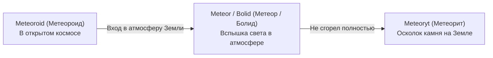

#### 3.1. Краткая шпаргалка (*Krótka ściągawka*)

| Термин (*Termin*) | Где находится / происходит | Что это такое |
| :--- | :--- | :--- |
| **Метеороид** (*Meteoroid*) | В открытом космосе (*W otwartej przestrzeni kosmicznej*) | Твёрдое небесное тело |
| **Метеор** (*Meteor*) | В атмосфере Земли (*W atmosferze Ziemi*) | Вспышка света или след от сгорания (самые яркие — **болиды** / *bolidy*) |
| **Метеорит** (*Meteoryt*) | На поверхности Земли (*Na powierzchni Ziemi*) | Осколок камня, который долетел до земли |

---

### 4. Основные географические понятия и Высота объекта над горизонтом — *Podstawy geografii* (O)

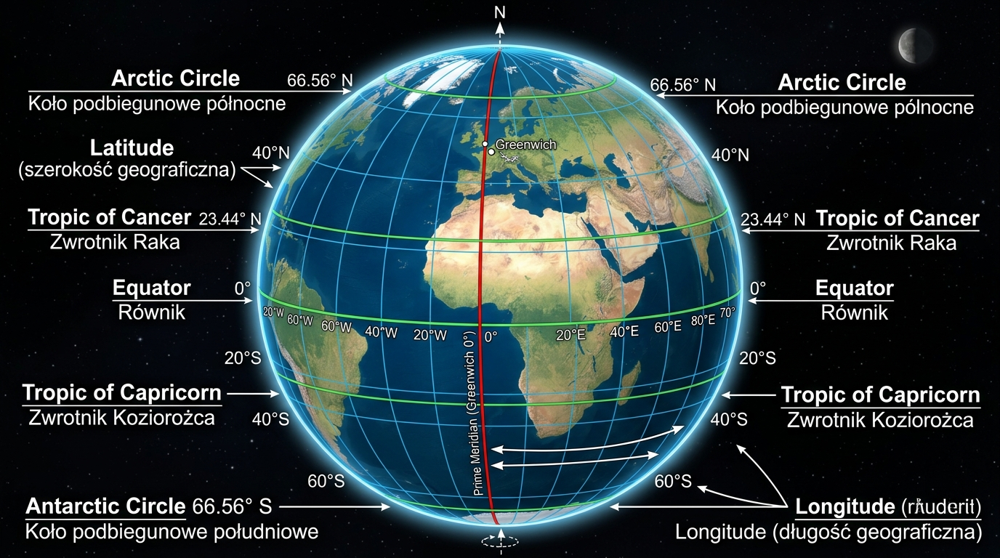

Для описания положения объектов на Земле и на небесной сфере используется градусная сетка координат:

* **Географическая широта (*szerokość geograficzna*, $\varphi$)**: Угловое расстояние от экватора к северу ($\text{N}$, $+0^\circ\text{--}90^\circ$) или к югу ($\text{S}$, $-0^\circ\text{--}90^\circ$).
* **Географическая долгота (*długość geograficzna*, $\lambda$)**: Угловое расстояние от начального (Гринвичского) меридиана к востоку ($\text{E}$, $+0^\circ\text{--}180^\circ$) или к западу ($\text{W}$, $-0^\circ\text{--}180^\circ$).

#### 4.1. Характерные параллели и регионы Земли

> 🔗 *Дополнительный материал: [Szerokość i długość geograficzna (Geografia24.pl)](https://geografia24.pl/szerokosc-i-dlugosc-geograficzna/)*

| Географический объект | Польский термин | Широта $\varphi$ | Астрономический и климатический смысл |
| :--- | :--- | :---: | :--- |
| **Экватор** | *Równik* | $0^\circ$ | Делит Землю на **Северное полушарие (*półkula północna*)** и **Южное полушарие (*półkula południowa*)**. День всегда равен ночи ($12\text{ ч}$). |
| **Тропик Рака (Северный тропик)** | *Zwrotnik Raka* | $+23^\circ 26' \text{ N} \ (\approx 23{,}44^\circ\text{ N})$ | Самая северная широта, где Солнце находится в зените ($h_\odot = 90^\circ$) в день летнего солнцестояния (20–21 июня). |
| **Тропик Козерога (Южный тропик)** | *Zwrotnik Koziorożca* | $-23^\circ 26' \text{ S} \ (\approx 23{,}44^\circ\text{ S})$ | Самая южная широта, где Солнце находится в зените ($h_\odot = 90^\circ$) в день зимнего солнцестояния (21–22 декабря). |
| **Северный полярный круг** | *Północne koło podbiegunowe* | $+66^\circ 34' \text{ N} \ (\approx 66{,}56^\circ\text{ N})$ | Южная граница территории, где наблюдаются **полярный день (*dzień polarny*)** и **полярная ночь (*noc polarna*)**. |
| **Южный полярный круг** | *Południowe koło podbiegunowe* | $-66^\circ 34' \text{ S} \ (\approx 66{,}56^\circ\text{ S})$ | Северная граница полярных явлений в Южном полушарии. |
| **Нулевой меридиан** | *Południk zerowy (Greenwich)* | $\lambda = 0^\circ$ | Начальный меридиан для отсчёта долготы и мирового времени (UTC). |
| **Северный / Южный полюс** | *Biegun północny / południowy* | $+90^\circ\text{ N} \ / \ -90^\circ\text{ S}$ | Точки пересечения оси суточного вращения Земли с её поверхностью. |

#### 4.2. Высота объекта над горизонтом и теорема о высоте полюса мира

1. **Высота светила над горизонтом (*wysokość obiektu*, $h$)**: Угловое расстояние от математического горизонта до светила вдоль круга высоты ($0^\circ \le h \le 90^\circ$).
2. **Зенитное расстояние (*odległość zenitalna*, $z$)**:
   $$z = 90^\circ - h$$
3. **Фундаментальная теорема сферической астрономии**: Высота Северного полюса мира $h_P$ над горизонтом строго равна географической широте места наблюдения $\varphi$:
   $$\mathbf{h_P = \varphi}$$
   *(Например, в Варшаве $\varphi \approx 52{,}2^\circ\text{ N}$, следовательно, Полярная звезда видна под углом $h \approx 52{,}2^\circ$ над горизонтом).*

---

### 5. Эклиптика Земли — *Ekliptyka Ziemi*

> 🔗 *Дополнительный материал: [Что такое эклиптика и почему она так важна? (Star Walk)](https://starwalk.space/ru/news/what-is-the-ecliptic)*

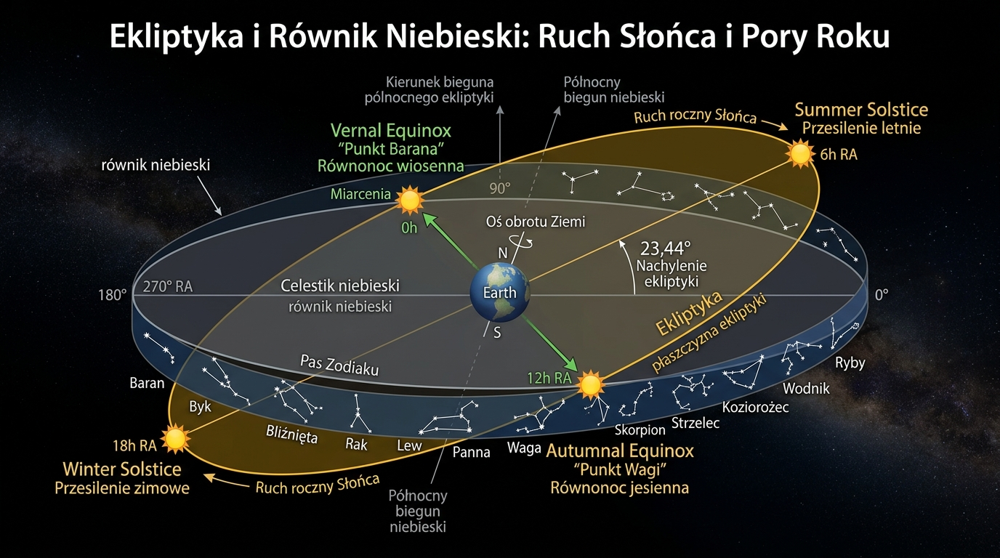

**Эклиптика (*ekliptyka*)** — ключевое понятие в сферической астрономии:

1. **Для земного наблюдателя**: Это кажущийся годовой путь Солнца по небесной сфере среди звёзд.
2. **Для космического наблюдателя**: Это плоскость орбиты обращения Земли вокруг Солнца (**плоскость эклиптики / *płaszczyzna ekliptyki***).

#### 5.1. Пересечение с небесным экватором и точки равноденствий

Плоскость эклиптики наклонена к плоскости **небесного экватора (*równik niebieski*)** под углом $\varepsilon \approx 23{,}44^\circ$ ($23^\circ 26'$), обусловленным наклоном оси вращения Земли.

Они пересекаются в двух диаметрально противоположных точках:

1. **Точка весеннего равноденствия (*punkt Barana*, $\Upsilon$)**:
   * Солнце пересекает небесный экватор, переходя из Южного полушария небесной сферы в Северное (около 20–21 марта).
   * В этот день на всей Земле день равен ночи ($12\text{ ч}$).
2. **Точка осеннего равноденствия (*punkt Wagi*, $\Omega$)**:
   * Солнце пересекает небесный экватор, переходя из Северного полушария в Южное (около 22–23 сентября).

#### 5.2. Точки солнцестояния (*Przesilenia*)

1. **Летнее солнцестояние (*przesilenie letnie*)**: Точка эклиптики с наибольшим склонением ($+23{,}44^\circ$, около 20–21 июня). В Северном полушарии — самый длинный день и самая короткая ночь.
2. **Зимнее солнцестояние (*przesilenie zimowe*)**: Точка эклиптики с наименьшим склонением ($-23{,}44^\circ$, около 21–22 декабря). В Северном полушарии — самый короткий день.

#### 5.3. Созвездия эклиптики (Зодиакальный пояс — *Gwiazdozbiory ekliptyczne / Zodiak*)

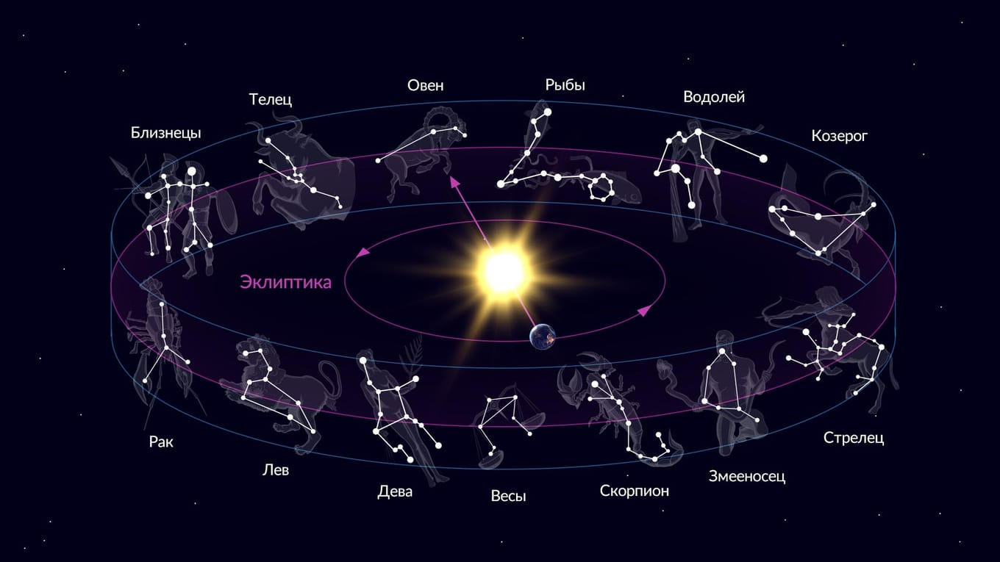
*Источник иллюстрации: [Star Walk — Созвездия эклиптики](https://starwalk.space/gallery/images/ecliptic-constellations/ru/1360x765.jpg)*

В течение года Солнце, двигаясь по эклиптике, проходит через **13 эклиптических созвездий**: 12 традиционных зодиакальных созвездий (*gwiazdozbiory zodiakalne*: Овен — *Baran*, Телец — *Byk*, Близнецы — *Bliźnięta*, Рак — *Rak*, Лев — *Lew*, Дева — *Panna*, Весы — *Waga*, Скорпион — *Skorpion*, Стрелец — *Strzelec*, Козерог — *Koziorożec*, Водолей — *Wodnik*, Рыбы — *Ryby*) и 13-е астрономическое созвездие — **Змееносец (*Wężownik / Ophiuchus*)**.

#### 5.4. Зодиакальный свет — *Światło zodiakalne*

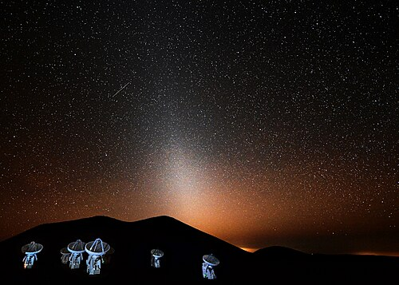
*Источник иллюстрации: [Wikimedia Commons — Zodiacal Light at Mauna Kea](https://thumb.wikimedia.org/wikipedia/commons/thumb/9/9a/Submillimeter_Array_Night.jpg/500px-Submillimeter_Array_Night.jpg?utm_source=en.wikipedia.org&utm_campaign=parser&utm_content=thumbnail)*

* **Światło zodiakalne (Зодиакальный свет)** — это слабое свечение, которое видно на небе перед рассветом или после заката в виде вытянутого конуса. Оно возникает из-за солнечного света, рассеивающегося на частицах космической пыли (*pył kosmiczny*) в плоскости эклиптики (*płaszczyzna ekliptyki*).

#### 5.5. Лунные узлы — *Węzły księżycowe*

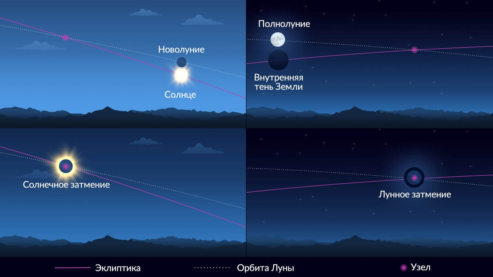
*Источник иллюстрации: [Star Walk — Эклиптика, орбита Луны и затмения](https://starwalk.space/gallery/images/ecliptic-moon/ru/1360x765.jpg)*

* **Węzły księżycowe** — *węzły orbity Księżyca, czyli punkty, w których orbita ta przecina płaszczyznę ekliptyki*.
* **Узлы** — это точки, в которых орбита Луны пересекает эклиптику. Полнолуние (*pełnia*) в этих точках приводит к **лунному затмению** (*zaćmienie Księżyca*), а новолуние (*nów*) — к **солнечному затмению** (*zaćmienie Słońca*). Если полнолуние или новолуние происходит в других точках орбиты Луны, затмения не будет.

---

### 6. Rozpoznawanie gwiazdozbiorów — Поиск созвездий и Полярной звезды

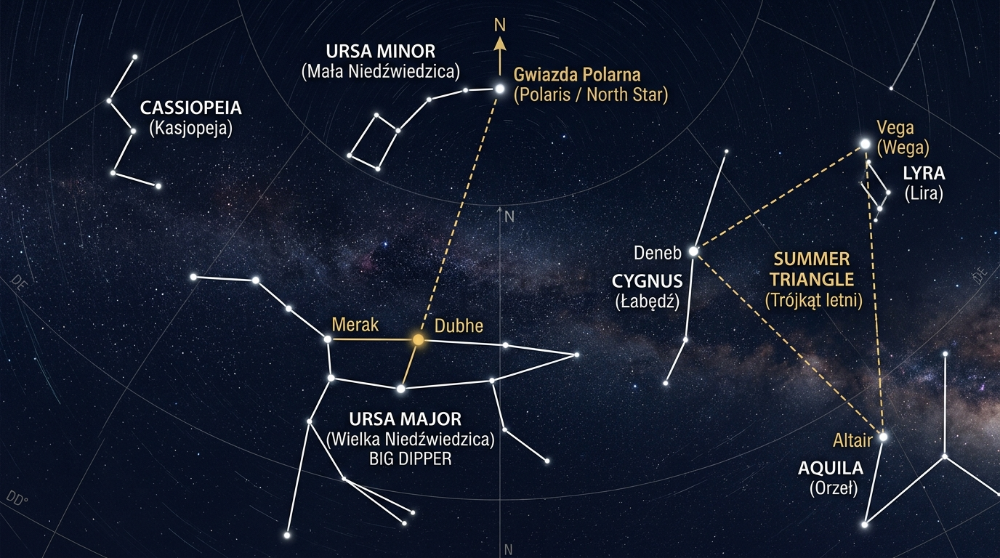

Ориентация по ночному небу — фундаментальный навык астронома:

1. **Поиск Полярной звезды (*Gwiazda Polarna / Polaris*)**:
   * Найти созвездие **Большой Медведицы (*Wielka Niedźwiedzica / Ursa Major*)**, в частности её яркую часть — Большой Ковш (*Wielki Wóz*).
   * Найти две крайние звезды стенки ковша: **Мерак (*Merak*)** и **Дубхе (*Dubhe*)**.
   * Мысленно провести луч от Мерака через Дубхе и отложить вдоль него расстояние, равное **5 отрезкам Merak–Dubhe**.
   * Луч точно укажет на **Полярную звезду (*Gwiazda Polarna / Polaris*)** — ярчайшую звезду на конце хвоста **Малой Медведицы (*Mała Niedźwiedzica / Ursa Minor*)**.

#### 6.1. Как использовать Полярную звезду для ориентации (*Jak wykorzystać Gwiazdę Polarną do orientacji w terenie / wyznaczania kierunków świata*)

* **Определение сторон света (*wyznaczanie kierunków świata / stron horyzontu*)**:
  Если вы встанете лицом к **Полярной звезде (*twarzą do Gwiazdy Polarnej*)**, то:
  * строго **впереди (*przed sobą / na wprost*)** будет **север (*północ*, $\text{N}$)**;
  * **сзади (*za sobą / z tyłu*)** — **юг (*południe*, $\text{S}$)**;
  * **слева (*po lewej stronie*)** — **запад (*zachód*, $\text{W}$)**;
  * **справа (*po prawej stronie*)** — **восток (*wschód*, $\text{E}$)**.
* **Определение географической широты (*wyznaczanie szerokości geograficznej*)**:
  **Высота Полярной звезды над горизонтом (*wysokość Gwiazdy Polarnej nad horyzontem*, $h_P$)** примерно равна **географической широте места наблюдения (*szerokość geograficzna miejsca obserwacji*, $\varphi$)**:
  $$\mathbf{h_P \approx \varphi}$$
  Например, для **средней полосы / умеренных широт (*umiarkowane szerokości geograficzne*)** это около $50^\circ\text{--}60^\circ$ градусов (*stopni*, для Польши — около $49^\circ\text{--}55^\circ\text{ N}$).

| Положение относительно наблюдателя (*Położenie względem obserwatora*) | Сторона света по-русски | Сторона света по-польски (*Kierunek świata*) | Обозначение (*Symbol*) |
| :--- | :---: | :---: | :---: |
| **Впереди** (лицом к Полярной звезде) — *Przed sobą (na wprost)* | **Север** | ***Północ*** | $\mathbf{N}$ |
| **Сзади** (за спиной) — *Za sobą (z tyłu)* | **Юг** | ***Południe*** | $\mathbf{S}$ |
| **Слева** (по левую руку) — *Po lewej stronie* | **Запад** | ***Zachód*** | $\mathbf{W}$ |
| **Справа** (по правую руку) — *Po prawej stronie* | **Восток** | ***Wschód*** | $\mathbf{E}$ |

2. **Главные незаходящие созвездия Северного полушария (*gwiazdozbiory okołobiegunowe*)**:
   * **Большая Медведица (*Ursa Major / Wielka Niedźwiedzica*)**;
   * **Малая Медведица (*Ursa Minor / Mała Niedźwiedzica*)**;
   * **Кассиопея (*Cassiopeia / Kasjopeja*)** — имеет характерную форму буквы **«W»** (или «M»).

3. **Летне-осенний треугольник (*Trójkąt letni*)**:
   * Состоит из трёх ярких звёзд разных созвездий:
     * **Вега (*Wega*)** в созвездии **Лиры (*Lira / Lyra*)**;
     * **Денеб (*Deneb*)** в созвездии **Лебедя (*Łabędź / Cygnus*)**;
     * **Альтаир (*Altair*)** в созвездии **Орла (*Orzeł / Aquila*)**.

---

### 7. Ruch jednostajny po okręgu — Равномерное движение по окружности

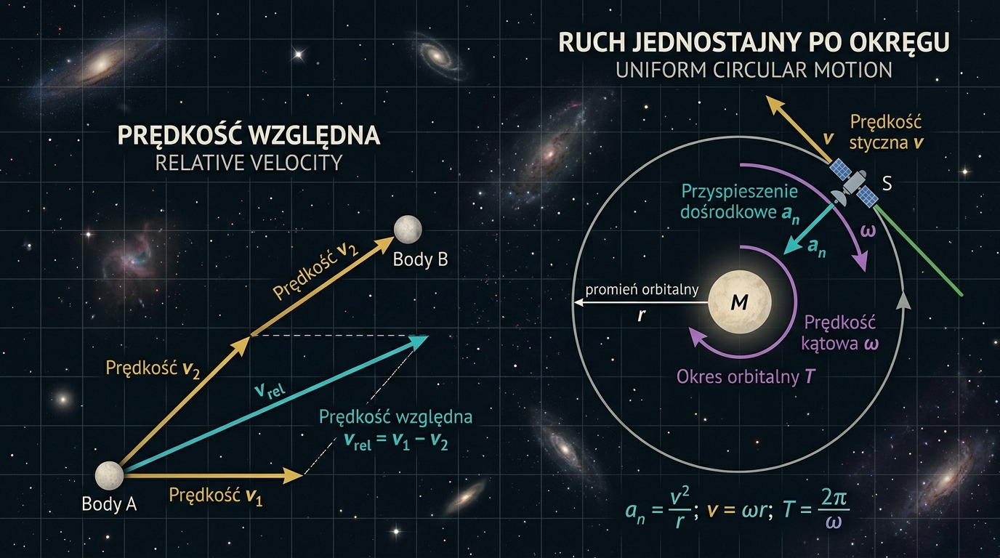

Многие орбитальные движения планет и спутников моделируются как **равномерное движение по окружности (*ruch jednostajny po okręgu*)**:

#### 7.1. Кинематические параметры

1. **Период обращения ($T$)**: Время одного полного оборота на $360^\circ$ ($2\pi\text{ рад}$) [секунды, $\text{с}$].
2. **Частота обращения ($f$)**: Число оборотов в единицу времени [Герцы, $\text{Гц} = 1/\text{с}$]:
   $$f = \frac{1}{T}$$
3. **Угловая скорость ($\omega$)**: Угол поворота в единицу времени [радианы в секунду, $\text{рад/с}$]:
   $$\omega = \frac{2\pi}{T} = 2\pi f$$
4. **Линейная (касательная) скорость ($v$)**: Модуль скорости движения по дуге окружности радиуса $r$ [метры в секунду, $\text{м/с}$]:
   $$v = \frac{2\pi r}{T} = \omega r$$
5. **Центростремительное ускорение ($a_n$)**: Ускорение, направленное к центру окружности и изменяющее направление вектора скорости:
   $$a_n = \frac{v^2}{r} = \omega^2 r = \frac{4\pi^2 r}{T^2}$$

---

### 8. Prędkość względna — Относительная скорость в астрономии

Вектор **относительной скорости (*prędkość względna*)** тела 1 относительно тела 2 равна векторной разности их скоростей относительно выбранной системы отсчёта (например, Солнца):

$$\mathbf{v}_{\text{rel}} = \mathbf{v}_1 - \mathbf{v}_2$$

#### 8.1. Частные случаи скалярного расчёта:

1. **Движение в одном направлении** (например, Земля и внешняя планета в противостоянии):
   $$v_{\text{rel}} = |v_1 - v_2|$$
2. **Движение в противоположных направлениях**:
   $$v_{\text{rel}} = v_1 + v_2$$
3. **Движение под углом $90^\circ$** (например, Земля и планета в квадратуре):
   $$v_{\text{rel}} = \sqrt{v_1^2 + v_2^2}$$

---

### 9. Orbity kołowe — Круговые орбиты (O)

> 🔗 *Дополнительный материал: [Законы Кеплера (Дом Знаний)](https://domznaniy.school/articles/zakony-keplera#h1)*

Круговая орбита является частным случаем эллиптической орбиты с эксцентриситетом $e = 0$. Таким образом, закономерности, описанные Кеплером, получили физическое объяснение через концепцию гравитационного взаимодействия.

#### 9.1. Условие существования круговой орбиты и первая космическая скорость

**Закон всемирного тяготения (*Prawo powszechnego ciążenia*)** гласит: любые два тела притягиваются друг к другу с силой, которая прямо пропорциональна произведению их масс и обратно пропорциональна квадрату расстояния между ними.

Формула закона:

$$F = G \frac{m_1 m_2}{r^2}$$

где:
* $F$ — сила притяжения (в ньютонах, $\text{Н}$);
* $G$ — гравитационная постоянная ($G \approx 6{,}67 \times 10^{-11}\text{ м}^3 \cdot \text{кг}^{-1} \cdot \text{с}^{-2}$);
* $m_1$ и $m_2$ — массы тел (в килограммах, $\text{кг}$);
* $r$ — расстояние между центрами масс тел (в метрах, $\text{м}$).

Движение спутника массой $m$ вокруг центрального тела массой $M \gg m$ по круговой орбите радиуса $r$ (или $R$) обеспечивается тем, что сила гравитационного притяжения выступает в роли центростремительной силы:

$$F_{\text{graw}} = F_{\text{dośrodkowa}} \quad \implies \quad G \frac{M m}{r^2} = \frac{m v^2}{r}$$

где:
* $F_{\text{graw}}$ — сила гравитационного притяжения (в ньютонах, $\text{Н}$);
* $F_{\text{dośrodkowa}}$ — центростремительная сила (в ньютонах, $\text{Н}$);
* $G$ — гравитационная постоянная ($G \approx 6{,}67 \times 10^{-11}\text{ м}^3 \cdot \text{кг}^{-1} \cdot \text{с}^{-2}$);
* $M$ — масса центрального тела / планеты (в килограммах, $\text{кг}$);
* $m$ — масса спутника / обращающегося тела (в килограммах, $\text{кг}$);
* $r$ — радиус круговой орбиты, то есть расстояние от центра планеты до объекта (в метрах, $\text{м}$);
* $v$ — линейная орбитальная скорость движения тела по окружности (в $\text{м/с}$).

Если нужно запустить спутник, то его необходимо разогнать до **первой космической скорости (*pierwsza prędkość kosmiczna*)** — это минимальная начальная скорость, которую нужно сообщить телу, чтобы оно вышло на стабильную круговую орбиту вокруг планеты и стало её искусственным спутником (*sztuczny satelita*):

$$\mathbf{v_1 = \sqrt{G \frac{M}{R}}}$$

где:
* $v_1$ — первая космическая (круговая) скорость (в $\text{м/с}$);
* $G$ — гравитационная постоянная ($G \approx 6{,}67 \times 10^{-11}\text{ м}^3 \cdot \text{кг}^{-1} \cdot \text{с}^{-2}$);
* $M$ — масса планеты или центрального светила (в килограммах, $\text{кг}$);
* $R$ (или $r$) — радиус орбиты (расстояние от центра планеты до объекта, в метрах, $\text{м}$).

Чтобы вырваться из орбитальных «объятий» и уйти дальше в космос, нужно разгоняться до **второй космической скорости** ($v_2 = \sqrt{2}\,v_1$).

---

#### 9.2. Связь радиуса орбиты и периода. III закон Кеплера (*III prawo Keplera*)

Подставляя формулу линейной скорости равномерного движения по окружности $v = \frac{2\pi r}{T}$ в условие равновесия $v^2 = \frac{G M}{r}$, получаем:

$$\frac{4\pi^2 r^2}{T^2} = \frac{G M}{r} \quad \implies \quad \mathbf{\frac{r^3}{T^2} = \frac{G M}{4\pi^2} = \text{const}}$$

где:
* $r$ — радиус круговой орбиты (расстояние от центра центрального тела до планеты/спутника, в метрах, $\text{м}$, или астрономических единицах, $\text{au}$);
* $T$ — сидерический (звёздный) период обращения тела по орбите (время одного полного оборота, в секундах, $\text{с}$, или земных годах);
* $G$ — гравитационная постоянная ($G \approx 6{,}67 \times 10^{-11}\text{ м}^3 \cdot \text{кг}^{-1} \cdot \text{с}^{-2}$);
* $M$ — масса центрального тела, вокруг которого происходит обращение (например, масса Солнца $M_\odot$, в килограммах, $\text{кг}$);
* $\pi \approx 3{,}14159$ — математическая константа (число «пи»).

Это выражение представляет собой **III закон Кеплера (*III prawo Keplera*) для круговых орбит**.

> 📌 **Формулировка III закона Кеплера (*Sformułowanie III prawa Keplera*)**:
> **Квадраты звёздных (сидерических) периодов обращения двух планет вокруг Солнца относятся друг к другу так же, как кубы больших полуосей (а для круговых орбит — кубы радиусов) их орбит.**
> *(Kwadraty okresów obiegu planet wokół Słońca są wprost proporcjonalne do sześcianów wielkich półosi / promieni ich orbit).*

В виде пропорции для двух любых планет (или спутников), обращающихся вокруг одного и того же центрального тела:

$$\mathbf{\frac{T_1^2}{T_2^2} = \frac{r_1^3}{r_2^3}} \quad \left(\text{или для эллиптических орбит: } \frac{T_1^2}{T_2^2} = \frac{a_1^3}{a_2^3}\right)$$

где:
* $T_1$ и $T_2$ — периоды обращения первой и второй планеты вокруг Солнца;
* $r_1$ и $r_2$ — радиусы круговых орбит первой и второй планеты (или $a_1, a_2$ — большие полуоси их орбит).

💡 **Удобное следствие для Солнечной системы**:
Если в качестве второй планеты взять **Землю (*Ziemia*)**, для которой период обращения равен $T_\oplus = 1\text{ год}$, а радиус орбиты равен $r_\oplus = 1\text{ au}$ (одна астрономическая единица), то формула III закона Кеплера для любой другой планеты максимально упрощается:

$$\mathbf{T^2 = r^3}$$

где:
* $T$ — период обращения планеты вокруг Солнца (в **земных годах**);
* $r$ (или $a$) — радиус орбиты / среднее расстояние планеты от Солнца (в **астрономических единицах, $\text{au}$**).

---

#### 9.3. Простой пример расчёта для планеты по III закону Кеплера

**Задача (на примере Юпитера — *Jowisz*)**:
Среднее расстояние от Юпитера до Солнца (радиус его почти круговой орбиты) составляет примерно $r_1 \approx 5{,}2\text{ au}$. Известно, что Земля обращается вокруг Солнца на расстоянии $r_2 = 1\text{ au}$ с периодом $T_2 = 1\text{ год}$. Сколько земных лет длится один год на Юпитере (его период обращения $T_1$)?

**Решение**:
1. Запишем формулу III закона Кеплера для Юпитера (индекс $1$) и Земли (индекс $2$):
   $$\frac{T_1^2}{T_2^2} = \frac{r_1^3}{r_2^3}$$
2. Подставим известные данные для Земли ($T_2 = 1\text{ год}$, $r_2 = 1\text{ au}$) и расстояние Юпитера ($r_1 = 5{,}2\text{ au}$):
   $$\frac{T_1^2}{1^2} = \frac{5{,}2^3}{1^3} \quad \implies \quad T_1^2 = 5{,}2^3$$
3. Возведём $5{,}2$ в куб:
   $$T_1^2 = 5{,}2 \times 5{,}2 \times 5{,}2 = 140{,}608$$
4. Извлечём квадратный корень, чтобы найти период $T_1$:
   $$T_1 = \sqrt{140{,}608} \approx 11{,}86\text{ земных лет}$$

**Ответ**: Один оборот Юпитера вокруг Солнца занимает около **$11{,}86\text{ лет}$** (почти $12$ земных лет).

---

### 10. Геометрия орбит и параметров: Перигелий, Афелий, Эксцентриситет

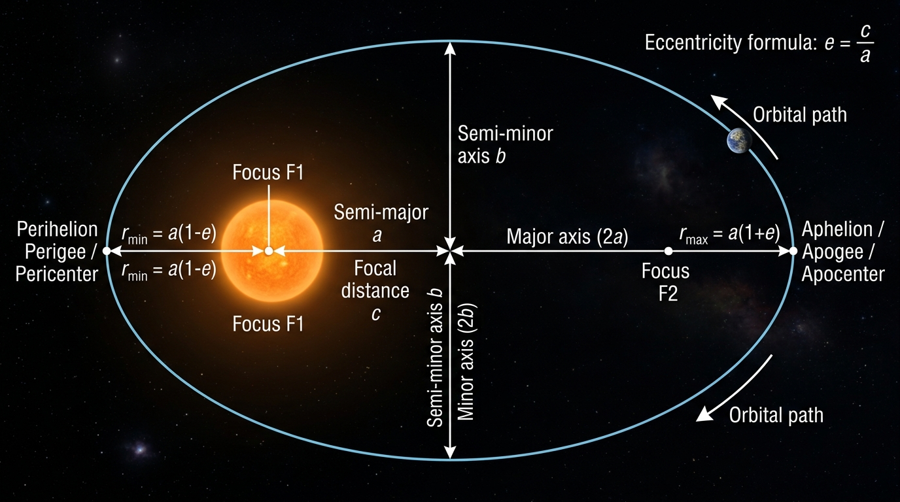

Точки наименьшего и наибольшего расстояния от фокуса называют **апсидами (*apsydy*)**:

1. **Перицентр (*perycentrum*)**: Точка орбиты, ближайшая к центральному гравитационному телу.
   * Для гелиоцентрической орбиты — **перигелий (*peryhelium*)**: точка минимального расстояния до Солнца:
     $$r_{\text{min}} = q = a(1-e)$$
   * Для геоцентрической орбиты — **перигей (*perygeum*)**: точка минимального расстояния до центра Земли:
     $$r_{\text{min}} = a(1-e)$$
2. **Апоцентр (*apocentrum*)**: Точка орбиты, наиболее удалённая от центрального гравитационного тела.
   * Для гелиоцентрической орбиты — **афелий (*aphelium*)**: точка максимального расстояния до Солнца:
     $$r_{\text{max}} = Q = a(1+e)$$
   * Для геоцентрической орбиты — **апогей (*apogeum*)**: точка максимального расстояния до центра Земли:
     $$r_{\text{max}} = a(1+e)$$
3. **Параметры эллиптической орбиты**:
   * $a$ — большая полуось эллипса (*półoś wielka*);
   * $b$ — малая полуось эллипса (*półoś mała*);
   * $c = \sqrt{a^2 - b^2}$ — фокальное расстояние (*odległość ogniskowa*);
   * $e$ — **эксцентриситет орбиты (*mimośród / ekscentryczność*)**:
     $$e = \frac{c}{a} = \sqrt{1 - \frac{b^2}{a^2}} = \frac{r_{\text{max}} - r_{\text{min}}}{r_{\text{max}} + r_{\text{min}}}$$

---

### 11. Элонгация (*Elongacja*) и конфигурации планет

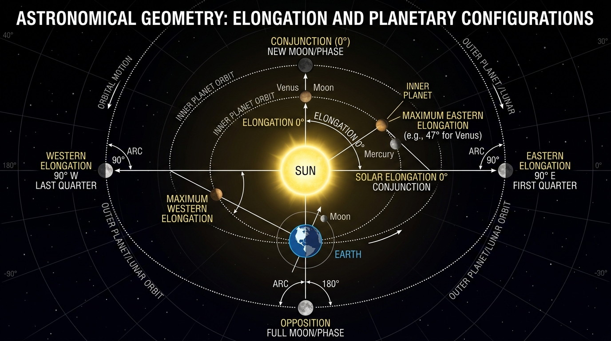

**Элонгация (*elongacja*)** — это угловое расстояние между Солнцем и планетным телом (или Луной), наблюдаемое с Земли.

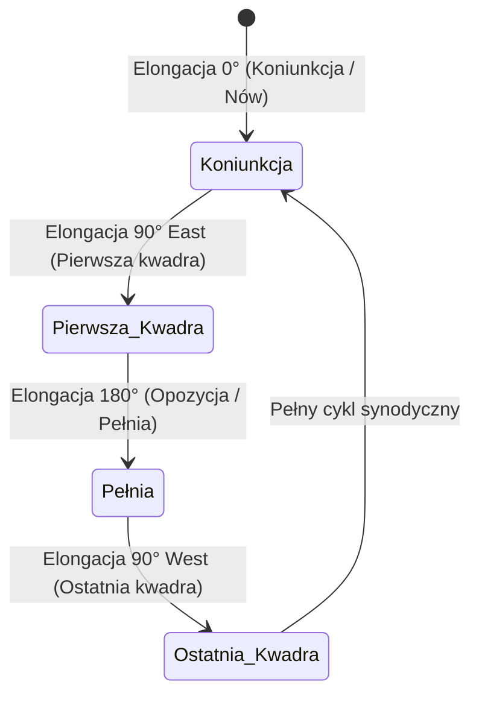

#### Характерные углы элонгации:

* **Соединение (*koniunkcja*) — элонгация $0^\circ$**: Светило находится на одной линии с Солнцем. В случае Луны — фаза **новолуние (*nów*)**.
* **Восточная элонгация $90^\circ\text{ E}$**: Светило находится на $90^\circ$ к востоку от Солнца. Видно вечером после заката. Для Луны — фаза **первая четверть (*pierwsza kwadra*)**.
* **Противостояние (*opozycja*) — элонгация $180^\circ$**: Светило находится на противоположной стороне неба от Солнца. Для Луны — фаза **полнолуние (*pełnia*)**. Видно всю ночь.
* **Западная элонгация $90^\circ\text{ W}$**: Светило находится на $90^\circ$ к западу от Солнца. Видно утром перед восходом. Для Луны — фаза **последняя четверть (*ostatnia kwadra*)**.
* **Максимальная элонгация внутренних планет (*maksymalna elongacja*)**: Внутренние планеты (Меркурий и Венера) не могут уходить на угол $180^\circ$. Их максимальный угловой уход ограничен орбитой:
  * Меркурий: $\psi_{\text{max}} \approx 18^\circ\text{--}28^\circ$
  * Венера: $\psi_{\text{max}} \approx 45^\circ\text{--}48^\circ$

---

### 12. Форма и радиусы Земли (*Promienie Ziemi*)

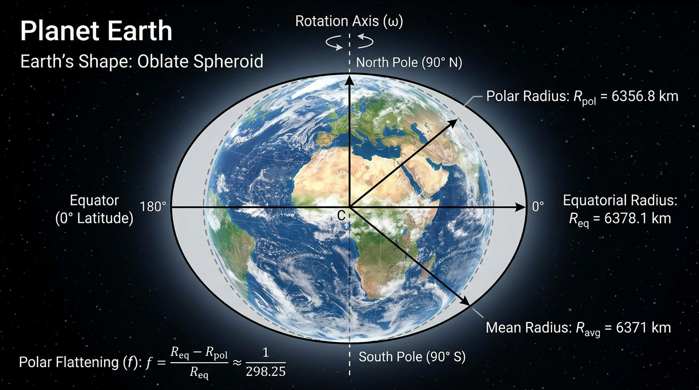

Из-за суточного вращения центробежная сила придает Земле форму **сплюснутого эллипсоида вращения (геоида)**:

1. **Экваториальный радиус (*promień równikowy*)**:
   $$R_{\text{eq}} \approx 6378{,}137\text{ км}$$
2. **Полярный радиус (*promień biegunowy*)**:
   $$R_{\text{pol}} \approx 6356{,}752\text{ км}$$
3. **Средний радиус Земли (*promień średni Ziemi*)**:
   $$R_\oplus = \sqrt[3]{R_{\text{eq}}^2 \cdot R_{\text{pol}}} \approx 6371{,}0008\text{ км} \approx 6371\text{ км}$$
4. **Полярное сжатие (*spłaszczenie biegunowe*)**:
   $$f = \frac{R_{\text{eq}} - R_{\text{pol}}}{R_{\text{eq}}} = \frac{6378{,}137 - 6356{,}752}{6378{,}137} \approx \frac{1}{298{,}257} \approx 0{,}003353$$

---

### 13. Расчёт суток в астрономии: Звёздные и Солнечные сутки (*Doba gwiazdowa a słoneczna*)

В астрономии строго различают два типа суток в зависимости от точки отсчёта:

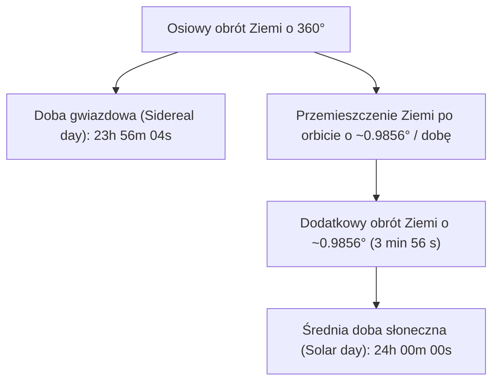

#### 13.1. Звёздные сутки (*Doba gwiazdowa*)
* **Точная продолжительность**:
  $$T_{\text{sid}} = 23^{\text{h}} 56^{\text{m}} 04{,}0905^{\text{s}} = 86164{,}0905\text{ секунд}$$

#### 13.2. Средние солнечные сутки (*Doba słoneczna*)
* **Точная продолжительность**:
  $$T_{\text{sol}} = 24^{\text{h}} 00^{\text{m}} 00^{\text{s}} = 86400\text{ секунд}$$

#### 13.3. Вывод разницы 3 мин 56 с
За одни сутки угловое смещение Земли по гелиоцентрической орбите составляет:

$$\Delta \theta = \frac{360^\circ}{365{,}2564} \approx 0{,}9856^\circ \approx 59' 08''$$

Время, необходимое Земле для поворота на $\Delta \theta = 0{,}9856^\circ$:

$$\Delta t = \frac{0{,}9856^\circ}{360^\circ} \times 86400\text{ с} \approx 236{,}55\text{ с} \approx 3\text{ мин } 56\text{ с}$$

---

### 14. Времена года и Высота Солнца над горизонтом (*Pory roku*) (O)

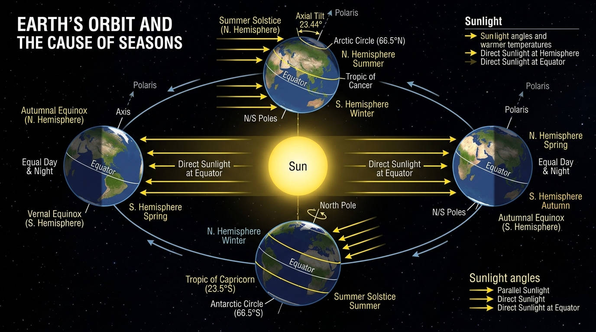

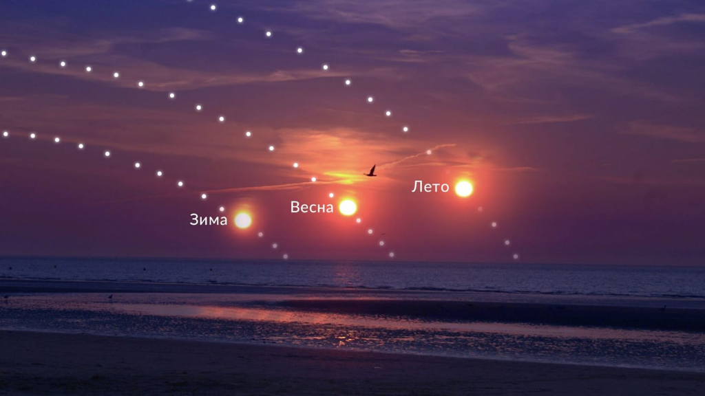

#### 14.1. Истинная причина смены времён года
Причина кроется в наклоне оси вращения Земли к нормали плоскости эклиптики на угол $\varepsilon \approx 23{,}44^\circ$.

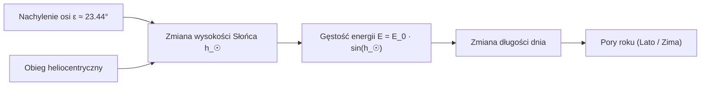

Поток лучистой энергии (*strumień promieniowania*):

$$E = E_0 \cdot \sin h_\odot$$

где $E_0 \approx 1361\text{ Вт/м}^2$ — солнечная постоянная, $h_\odot$ — угловая высота Солнца.

#### 14.2. Смещение точек восхода и заката Солнца в течение года (*Wschody i zachody Słońca w ciągu roku*)

Большинство людей уверены: «Солнце всегда встаёт на востоке (*na wschodzie*), а садится на западе (*na zachodzie*)». На самом деле строго на востоке и западе это происходит **только два дня в году** — в дни весеннего и осеннего равноденствий (*równonoc wiosenna i jesienna*, около 21 марта и 23 сентября).

* **Как это представить**: Ось Земли наклонена. Когда в Северном полушарии (*półkula północna*) весна и лето, наша «макушка» (Северный полюс) наклонена к Солнцу. Представь, что ты смотришь на восходящее Солнце ранним июньским утром: Земля подставляет Солнцу свою верхнюю (северную) часть, поэтому точки восхода и заката смещаются ближе к северу — на **северо-восток (*północny wschód*, $\text{NE}$)** и **северо-запад (*północny zachód*, $\text{NW}$)**.
* **Простая цифра**: От весеннего до осеннего равноденствия проходит ровно половина года — около **182 дней**. Всё это время Солнце встаёт и садится с северным смещением. А осенью и зимой — наоборот, точки восхода и заката смещаются к югу (на **юго-восток, $\text{SE}$**, и **юго-запад, $\text{SW}$**).

---

### 15. Луна, фазы и затмения — *Księżyc, Fazy i Zaćmienia* (O)

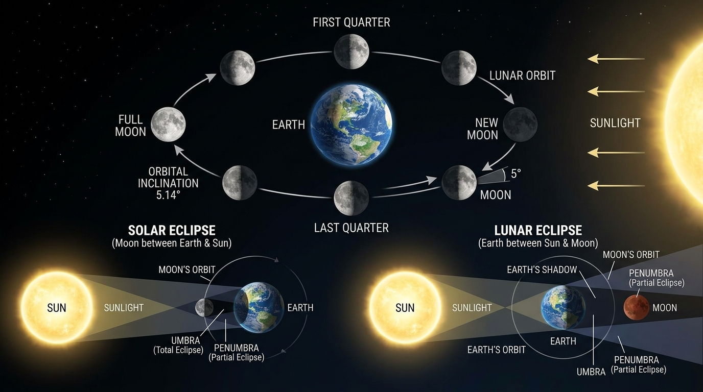

#### 15.1. Параметры Луны
* **Масса**: $M_{\text{Moon}} \approx 73\,420\,000\,000\,000\,000\,000\,000\text{ кг} \approx 7{,}342 \cdot 10^{22}\text{ кг} \approx \frac{1}{81,3} M_\oplus$
* **Радиус**: $R_{\text{Moon}} \approx 1737{,}1\text{ км} \approx 0{,}2727 R_\oplus$
* **Ускорение свободного падения**: $g_{\text{Moon}} \approx 1{,}62\text{ м/с}^2 \approx \frac{1}{6} g_\oplus$

#### 15.2. Месяц сидерический и синодический, Фазы Луны (O)
* **Сидерический месяц (*miesiąc gwiazdowy*)**: Период обращения относительно звёзд ($T_{\text{sid}} \approx 27{,}32\text{ сут}$).
* **Синодический месяц (*miesiąc synodyczny*)**: Период смены фаз от новолуния до новолуния ($S \approx 29{,}53\text{ сут}$):
  $$\frac{1}{S} = \frac{1}{T_{\text{sid}}} - \frac{1}{T_\oplus}$$

#### 15.3. Затмения Солнца и Луны — *Zaćmienie Słońca i Księżyca* (O)
1. **Солнечное затмение (*zaćmienie Słońca*)**: Происходит в фазе **новолуния (*nów*)**, когда Луна проходит между Землёй и Солнцем. Подразделяются на полное (*całkowite*), частичное (*częściowe*) и кольцеобразное (*obrączkowe*).
2. **Лунное затмение (*zaćmienie Księżyca*)**: Происходит в фазе **полнолуния (*pełnia*)**, когда Луна попадает в конус тени (*cień*) или полутени (*półcień*) Земли.
3. **Условие затмений**: Затмения происходят только тогда, когда Луна находится вблизи **лунных узлов (*węzły Księżyca*)** — точек пересечения орбиты Луны (наклон $i \approx 5{,}14^\circ$) с эклиптикой.

#### 15.4. Геометрия орбит: теорема Пифагора и затмения (*Geometria orbit: twierdzenie Pitagorasa a zaćmienia*)

Представим вид сверху на Солнечную систему: по большой окружности радиуса $r$ летит Земля (*Ziemia*), а вокруг неё по маленькой окружности радиуса $R$ летает Луна (*Księżyc*).

* **Почему расстояние от Луны до Солнца постоянно меняется?**
  Луна движется вместе с нами. Когда она оказывается строго между нами и Солнцем (**новолуние / *nów***), расстояние от неё до Солнца минимально:
  $$d_{\text{min}} = r - R$$
  Когда Луна уходит за Землю (**полнолуние / *pełnia***) — расстояние максимально:
  $$d_{\text{max}} = r + R$$
* **При чём здесь теорема Пифагора (*twierdzenie Pitagorasa*)?**
  Когда мы видим с Земли ровно половинку лунного диска (фазы **первой или последней четверти / *pierwsza lub ostatnia kwadra***), угол при Земле в треугольнике «Солнце — Земля — Луна» равен прямому углу ($90^\circ$). Здесь расстояние от Луны до Солнца (гипотенуза / *przeciwprostokątna*) как раз рассчитывается по теореме Пифагора:
  $$d = \sqrt{r^2 + R^2}$$
* **Как поймать солнечное затмение (*zaćmienie Słońca*)?**
  Оно случается только в **новолуние (*nów*)**, когда Луна встаёт точно на одну линию между нами и Солнцем. Значит, расстояние от Луны до Солнца в этот момент обязано быть строго равным:
  $$d = r - R$$

---

### 16. Математический аппарат, физика и геометрический инструментарий

В данном разделе собраны фундаментальные законы и формулы с описанием каждой переменной и единиц измерения СИ (SI):

#### 16.1. Закон всемирного тяготения Ньютона (*Prawo powszechnego ciążenia*)

$$F = G \frac{M m}{r^2}$$

* $F$ — сила гравитации [Ньютоны, $\text{Н}$].
* $G = 6{,}67430 \cdot 10^{-11}\text{ Н}\cdot\text{м}^2/\text{кг}^2$ — гравитационная постоянная.
* $M, m$ — массы взаимодействующих тел [килограммы, $\text{кг}$].
* $r$ — расстояние между центрами масс [метры, $\text{м}$].

#### 16.2. Ускорение свободного падения и Свободное падение тел

$$g = \frac{G M}{R^2}$$

Формулы свободного падения тела без начальной скорости ($v_0 = 0$):
* Скорость в момент времени $t$: $v = g t$
* Пройденный путь (высота): $h = \frac{1}{2} g t^2$
* Связь скорости и высоты: $v = \sqrt{2 g h}$

#### 16.3. Первая и Вторая космические скорости (*Pierwsza i druga prędkość kosmiczna*)

* **Первая космическая (круговая) скорость (*pierwsza prędkość kosmiczna*, $v_{\text{I}}$)** — это минимальная начальная скорость, которую нужно сообщить телу, чтобы оно вышло на стабильную круговую орбиту вокруг планеты и стало её искусственным спутником (*sztuczny satelita*):
  $$v_{\text{I}} = \sqrt{\frac{G M}{R}} = \sqrt{g R} \quad (v_{\text{I, Ziemia}} \approx 7{,}91\text{ км/с})$$
* **Вторая космическая скорость (*druga prędkość kosmiczna / prędkość ucieczki*, $v_{\text{II}}$)** — это минимальная скорость, которую нужно сообщить телу, чтобы оно навсегда преодолело гравитационное притяжение планеты и покинуло её окрестности по параболической траектории:
  $$v_{\text{II}} = \sqrt{\frac{2 G M}{R}} = \sqrt{2} \cdot v_{\text{I}} \quad (v_{\text{II, Ziemia}} \approx 11{,}19\text{ км/с})$$

#### 16.4. III закон Кеплера (*III prawo Keplera*)

$$\frac{T_1^2}{T_2^2} = \frac{a_1^3}{a_2^3} \quad \Longleftrightarrow \quad T^2 = a^3 \quad (\text{при } a \text{ в [au] и } T \text{ в земных годах})$$

#### 16.5. Закон инсоляции

$$E = E_0 \cdot \sin h_\odot$$

#### 16.6. Относительное движение и синодический период

$$\frac{1}{S} = \left| \frac{1}{T_1} - \frac{1}{T_2} \right|$$

#### 16.7. Notacja wykładnicza i jednostki SI — Научная нотация и СИ

1. **Экспоненциальная нотация (*notacja wykładnicza*)**: Запись числа в виде $A \cdot 10^n$, где $1 \le |A| < 10$, $n \in \mathbb{Z}$.
2. **Основные десятичные приставки SI**:
   * Тера ($\text{T}$) = $10^{12}$, Гига ($\text{G}$) = $10^9$, Мега ($\text{M}$) = $10^6$, Кило ($\text{k}$) = $10^3$.
   * Милли ($\text{m}$) = $10^{-3}$, Микро ($\mu$) = $10^{-6}$, Нано ($\text{n}$) = $10^{-9}$.

#### 16.8. Obliczanie długości okręgu i pola koła — Геометрия круга и сферы

1. **Длина окружности (*długość okręgu*)**:
   $$L = 2\pi r = \pi d$$
2. **Площадь круга (*pole koła*)**:
   $$S = \pi r^2 = \frac{\pi d^2}{4}$$
3. **Площадь поверхности сферы (*pole powierzchni kuli*)**:
   $$A = 4\pi R^2$$
4. **Объём шара (*objętość kuli*)**:
   $$V = \frac{4}{3}\pi R^3$$

---

### 17. Задачи для самостоятельного решения (*Zadania do samodzielnego rozwiązania*)

#### Задача 1. Расчёт ускорения свободного падения на поверхности Земли
Вычислить теоретическое ускорение свободного падения $g_\oplus$ на поверхности Земли, приняв $M_\oplus = 5\,972\,200\,000\,000\,000\,000\,000\,000\text{ кг}$, средний радиус $R_\oplus = 6371\text{ км}$ и $G = 6{,}67430 \cdot 10^{-11}\text{ Н}\cdot\text{м}^2/\text{кг}^2$.

#### Задача 2. Линейная скорость геостационарного спутника
Искусственный спутник Земли (*sztuczny satelita Ziemi*) движется по круговой орбите на геоцентрическом расстоянии $r = 42\,000\text{ км}$ от центра планеты. Найти его линейную скорость $v$.

#### Задача 3. Применение III закона Кеплера для астероида
Астероид Главного пояса движется вокруг Солнца по круговой орбите с большой полуосью $a = 4\text{ au}$. Определить период обращения астероида $T$ в земных годах.

#### Задача 4. Время падения тела с высоты
Камень падает без начальной скорости с обрыва высотой $h = 19{,}6\text{ м}$ на поверхности Земли ($g = 9{,}8\text{ м/с}^2$). Определить время падения $t$ и конечную скорость $v$.

#### Задача 5. Длина орбиты Земли
Принимая орбиту Земли вокруг Солнца за круговую радиуса $r = 1\text{ au} = 1{,}496 \cdot 10^{11}\text{ м}$, вычислить длину орбиты $L$ и среднюю орбитальную скорость Земли $v_\oplus$ в км/с.

---

### 18. Контрольные вопросы для самопроверки (*Pytania kontrolne*)

#### Базовый уровень
1. Что такое планета (*planeta*) и чем она фундаментально отличается от естественного спутника (*naturalny satelita*)?
2. Какова масса Солнца в килограммах точным числом без использования степеней 10?
3. Что такое астрономическая единица (*au*), световой год (*ly*) и парсек (*pc*)?
4. Как с помощью созвездия Большой Медведицы найти Полярную звезду (*Gwiazda Polarna*)?
5. Что такое эклиптика (*ekliptyka*) и под каким углом она наклонена к небесному экватору?
6. Назовите географический и астрономический смысл Тропика Рака (*Zwrotnik Raka*) и Северного полярного круга (*Północne koło podbiegunowe*).

#### Средний уровень
7. Почему высота Северного полюса мира $h_P$ равна географической широте места наблюдения $\varphi$?
8. Почему солнечные сутки (*doba słoneczna*) длиннее звёздных суток (*doba gwiazdowa*) ровно на 3 минуты 56 секунд? Выведите этот интервал математически.
9. В чём состоит отличие между термином «перигелий» (*peryhelium*) как точкой орбиты и «перигелийным расстоянием» ($r_{\text{min}} = q = a(1-e)$)?
10. Что такое элонгация (*elongacja*) и почему максимальная элонгация Венеры не может превышать $48^\circ$?
11. Каковы типы солнечных и лунных затмений и при каких условиях они возникают?

---

### 19. Раздел решений задач и ответов (*Rozwiązania zadań i Odpowiedzi*)

#### 19.1. Подробные решения задач из Раздела 17

* **Решение Задачи 1 (Расчёт $g_\oplus$)**:
  1. $R_\oplus = 6371\text{ км} = 6{,}371 \cdot 10^6\text{ м}$.
  2. $g = \frac{G M_\oplus}{R_\oplus^2} = \frac{6{,}67430 \cdot 10^{-11} \cdot 5{,}9722 \cdot 10^{24}}{(6{,}371 \cdot 10^6)^2} \approx 9{,}819\text{ м/с}^2$.
  * **Ответ**: $\mathbf{g_\oplus \approx 9{,}81\text{ м/с}^2}$.

* **Решение Задачи 2 (Скорость спутника $v$)**:
  1. $r = 42\,000\text{ км} = 4{,}2 \cdot 10^7\text{ м}$.
  2. $v = \sqrt{\frac{G M_\oplus}{r}} = \sqrt{\frac{6{,}67430 \cdot 10^{-11} \cdot 5{,}9722 \cdot 10^{24}}{4{,}2 \cdot 10^7}} \approx 3080{,}6\text{ м/с} \approx 3{,}08\text{ км/с}$.
  * **Ответ**: $\mathbf{v \approx 3{,}08\text{ км/с}}$.

* **Решение Задачи 3 (III закон Кеплера)**:
  1. $T^2 = a^3 \implies T^2 = 4^3 = 64 \implies T = 8\text{ лет}$.
  * **Ответ**: $\mathbf{T = 8\text{ лет}}$.

* **Решение Задачи 4 (Свободное падение)**:
  1. $t = \sqrt{\frac{2h}{g}} = \sqrt{\frac{2 \cdot 19{,}6}{9{,}8}} = \sqrt{4} = 2\text{ с}$.
  2. $v = g t = 9{,}8 \cdot 2 = 19{,}6\text{ м/с}$.
  * **Ответ**: $\mathbf{t = 2\text{ с}, v = 19{,}6\text{ м/с}}$.

* **Решение Задачи 5 (Длина орбиты и скорость Земли)**:
  1. $L = 2\pi r = 2 \cdot 3{,}14159 \cdot 1{,}496 \cdot 10^{11} \approx 9{,}40 \cdot 10^{11}\text{ м} \approx 940\text{ млн км}$.
  2. $v = \frac{L}{T} = \frac{9{,}40 \cdot 10^{11}\text{ м}}{31\,558\,150\text{ с}} \approx 29\,780\text{ м/с} \approx 29{,}8\text{ км/с}$.
  * **Ответ**: $\mathbf{L \approx 940\text{ млн км}, v_\oplus \approx 29{,}8\text{ км/с}}$.

---

#### 19.2. Ответы на контрольные вопросы из Раздела 18

1. **Планета vs Спутник**: Планета вращается напрямую вокруг звезды и расчистила свою орбиту; естественный спутник вращается вокруг планеты.
2. **Масса Солнца**: $1\,988\,500\,000\,000\,000\,000\,000\,000\,000\,000\text{ кг}$.
3. **Единицы расстояния**: $1\text{ au} = 149\,597\,870\,700\text{ м}$; $1\text{ ly} \approx 9{,}46 \cdot 10^{15}\text{ м}$; $1\text{ pc} \approx 3{,}2616\text{ ly} \approx 3{,}086 \cdot 10^{16}\text{ м}$.
4. **Поиск Полярной звезды**: Провести луч через звезды Мерак и Дубхе в Большой Медведице и отложить 5 их отрезков до Polaris в Малой Медведице.
5. **Эклиптика**: Видимый путь Солнца по небесной сфере (плоскость земной орбиты). Наклонена под углом $\varepsilon \approx 23{,}44^\circ$.
6. **Тропик Рака и Полярный круг**: Тропик Рака ($23{,}44^\circ\text{ N}$) — широта зенита Солнца в летнее солнцестояние; Полярный круг ($66{,}56^\circ\text{ N}$) — граница полярного дня и ночи.
7. **Высота полюса мира $h_P = \varphi$**: Угол наклона оси мира к горизонту математически равен географической широте наблюдателя.
8. **Вывод разницы суток**: За солнечные сутки Земля смещается по орбите на $\Delta \theta = \frac{360^\circ}{365{,}2564} \approx 0{,}9856^\circ$. Время доворота Земли: $\Delta t = \frac{0{,}9856^\circ}{360^\circ} \times 86400\text{ с} \approx 3\text{ мин } 56\text{ с}$.
9. **Перигелий vs Расстояние**: Перигелий — точка орбиты; перигелийное расстояние — минимальная дистанция $r_{\text{min}} = q = a(1-e)$.
10. **Элонгация Венеры**: Угловое расстояние от Солнца, ограниченное орбитой Венеры ($\sin \psi_{\text{max}} = \frac{a_{\text{Ven}}}{a_\oplus} \implies \psi_{\text{max}} \approx 46^\circ\text{--}48^\circ$).
11. **Затмения**: Солнечное в новолуние, лунное в полнолуние, при условии совпадения с лунными узлами.
